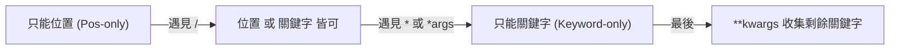

# Python 函式呼叫與引數傳遞完全指南 📘

> **課程單元**：Python 函式（Function）進階引數傳遞  
> **上課日期**：2026-11-18  
> **適用對象**：職能發展學院 Python 程式設計學員  

---

## 目錄 (Table of Contents)
- [1. 觀念釐清：參數 (Parameter) vs 引數 (Argument)](#1-觀念釐清參數-parameter-vs-引數-argument)
- [2. 兩種基本呼叫方式](#2-兩種基本呼叫方式)
  - [2.1 位置引數 (Positional Arguments)](#21-位置引數-positional-arguments)
  - [2.2 關鍵字引數 (Keyword Arguments)](#22-關鍵字引數-keyword-arguments)
  - [2.3 混合使用的「黃金鐵律」](#23-混合使用的黃金鐵律)
  - [2.4 預設參數 (Default Parameters)](#24-預設參數-default-parameters)
- [3. 特殊符號大解密：*、** 與 /](#3-特殊符號大解密----與-)
  - [3.1 `*args`：任意數量的位置引數（打包成 Tuple）](#31-args任意數量的位置引數打包成-tuple)
  - [3.2 `**kwargs`：任意數量的關鍵字引數（打包成 Dict）](#32-kwargs任意數量的關鍵字引數打包成-dict)
  - [3.3 單獨的 `*`：強制後方必須為關鍵字引數 (Keyword-Only)](#33-單獨的-強制後方必須為關鍵字引數-keyword-only)
  - [3.4 單獨的 `/`：強制前方只能為位置引數 (Positional-Only, Python 3.8+)](#34-單獨的-強制前方只能為位置引數-positional-only-python-38)
  - [3.5 呼叫時的解包技巧 (Unpacking：`*` 與 `**`)](#35-呼叫時的解包技巧-unpacking-與-)
- [4. 終極拼圖：參數定義順序總結表](#4-終極拼圖參數定義順序總結表)
- [5. 常見報錯與除錯指南 (Common Pitfalls)](#5-常見報錯與除錯指南-common-pitfalls)
- [6. 課堂隨堂實作與觀念測驗](#6-課堂隨堂實作與觀念測驗)

---

## 1. 觀念釐清：參數 (Parameter) vs 引數 (Argument)

在學習函式呼叫前，首先必須區分這兩個常被混用的名詞：

| 名詞 | 英文 | 發生時機 | 角色與意義 |
| :--- | :--- | :--- | :--- |
| **參數** | **Parameter** | **定義函式時** | 函式內部的變數名稱（佔位符號，Placeholder） |
| **引數** | **Argument** | **呼叫函式時** | 實際傳入函式的具體數值或物件（實際資料） |

```python
# a, b 是「參數 (Parameters)」
def calculate_rectangle_area(width, height):
    return width * height

# 10, 20 是「引數 (Arguments)」
area = calculate_rectangle_area(10, 20)
print(f"矩形面積：{area}")
```

---

## 2. 兩種基本呼叫方式

當我們要呼叫函式並傳入資料時，Python 提供兩種基本方式：

### 2.1 位置引數 (Positional Arguments)
依照定義時的**排列順序**依序對應傳入。這是最直觀的呼叫方式。

```python
def describe_pet(animal_type, pet_name):
    print(f"我有一隻 {animal_type}，名字叫 {pet_name}。")

# 依照順序傳入：第一個對應 animal_type，第二個對應 pet_name
describe_pet("小狗", "小白")
# 輸出：我有一隻 小狗，名字叫 小白。

# 若順序顛倒，語意可能錯誤：
describe_pet("小白", "小狗")
# 輸出：我有一隻 小白，名字叫 小狗。（語意不合）
```

### 2.2 關鍵字引數 (Keyword Arguments)
呼叫時明確指定「**參數名稱 = 引數值**」。此時順序不再受限！

```python
# 明確指定參數名稱，順序調換完全沒問題
describe_pet(pet_name="咪咪", animal_type="小貓")
# 輸出：我有一隻 小貓，名字叫 咪咪。
```

> [!TIP]
> **優點**：關鍵字引數可以大幅提高程式碼的可讀性，其他人閱讀程式碼時不需要去查函式定義，就能一眼看出傳入值的意義。

---

### 2.3 混合使用的「黃金鐵律」

在一次函式呼叫中，可以同時使用位置引數與關鍵字引數，但必須遵守以下鐵律：

> [!IMPORTANT]
> **黃金鐵律：位置引數永遠必須放在關鍵字引數的前面！**
> 一旦開始使用關鍵字引數，後續的所有引數都必須是關鍵字引數。

#### ❌ 錯誤示範：
```python
# SyntaxError: positional argument follows keyword argument
describe_pet(animal_type="小狗", "小白")
```

#### ✅ 正確示範：
```python
describe_pet("小狗", pet_name="小白")
```

---

### 2.4 預設參數 (Default Parameters)

定義函式時，可以給予參數預設值。如果呼叫時沒有傳入該引數，就會自動採用預設值。

```python
def make_coffee(coffee_type, milk=True, sugar_level="微糖"):
    print(f"咖啡種類: {coffee_type}, 加牛奶: {milk}, 甜度: {sugar_level}")

make_coffee("美式")                      # 採用 milk=True, sugar_level="微糖"
make_coffee("美式", milk=False)          # 覆寫 milk
make_coffee("拿鐵", sugar_level="無糖")   # 覆寫 sugar_level
```

---

## 3. 特殊符號大解密：*、** 與 /

在 Python 函式定義與呼叫中，`*`、`**` 以及 `/` 扮演了非常關鍵的角色。

### 3.1 `*args`：任意數量的位置引數（打包成 Tuple）

當你不知道呼叫者會傳入幾個位置引數時，可以在參數名稱前加上 `*`。習慣上命名為 `*args`（arguments 的簡寫）。

- **運作原理**：Python 會將所有多出來的位置引數「打包（Pack）」成一個 **Tuple（元組）**。

```python
def calculate_sum(*numbers):
    print("收到的 numbers 類型:", type(numbers))
    print("收到的 numbers 內容:", numbers)
    return sum(numbers)

# 可以傳入任意個數字
total1 = calculate_sum(1, 2, 3)
print("總和:", total1)  # 6

total2 = calculate_sum(10, 20, 30, 40, 50)
print("總和:", total2)  # 150

total3 = calculate_sum()  # 傳入 0 個也可以，numbers 會是 ()
print("總和:", total3)  # 0
```

---

### 3.2 `**kwargs`：任意數量的關鍵字引數（打包成 Dict）

當你想接收任意多個具名的關鍵字引數時，可以在參數名稱前加上 `**`。習慣上命名為 `**kwargs`（keyword arguments 的簡寫）。

- **運作原理**：Python 會將所有額外的 `鍵=值` 引數「打包（Pack）」成一個 **Dictionary（字典）**。

```python
def build_student_profile(name, age, **details):
    print(f"姓名: {name}, 年齡: {age}")
    print("其他補充資訊:", details)
    for key, value in details.items():
        print(f"  - {key}: {value}")

build_student_profile("王小明", 25, city="台北", major="資訊工程", hobby="羽球")
```

**輸出結果**：
```text
姓名: 王小明, 年齡: 25
其他補充資訊: {'city': '台北', 'major': '資訊工程', 'hobby': '羽球'}
  - city: 台北
  - major: 資訊工程
  - hobby: 羽球
```

---

### 3.3 單獨的 `*`：強制後方必須為關鍵字引數 (Keyword-Only)

如果在參數列中放一個單獨的 `*`（後面不帶任何變數名稱），代表一個「分隔界線」：
- **`*` 後面的所有參數，在呼叫時「必須」使用關鍵字引數傳入，絕對不能用位置傳入！**

```python
def send_email(recipient, subject, *, cc=None, is_urgent=False):
    print(f"寄送郵件給: {recipient}")
    print(f"主旨: {subject}")
    print(f"副本: {cc}, 緊急: {is_urgent}")

# ✅ 合法呼叫：cc 與 is_urgent 使用關鍵字引數傳入
send_email("boss@company.com", "專案進度報告", is_urgent=True)

# ❌ 違法呼叫：使用位置引數傳給 cc
# TypeError: send_email() takes 2 positional arguments but 3 were given
send_email("boss@company.com", "專案進度報告", "manager@company.com")
```

> [!NOTE]
> **為什麼要這樣設計？**  
> 避免布林常數或選用設定造成語意混淆！例如 `set_user_status("Alice", True, False)` 讓人摸不著頭緒；但若強制為 `set_user_status("Alice", is_active=True, notify=False)`，程式碼一目了然且安全。

---

### 3.4 單獨的 `/`：強制前方只能為位置引數 (Positional-Only, Python 3.8+)

在 Python 3.8 新增的語法中，單獨的 `/` 也是一個界線符號：
- **`/` 前面的所有參數，在呼叫時「只能」使用位置引數傳入，「禁止」指定參數名稱！**

```python
def divide(a, b, /):
    return a / b

# ✅ 合法呼叫：純位置傳入
print(divide(10, 2))  # 5.0

# ❌ 違法呼叫：指定名稱傳入
# TypeError: divide() got some positional-only arguments passed as keyword arguments: 'a, b'
print(divide(a=10, b=2))
```

> [!NOTE]
> **為什麼要發明 `/` 符號？**
> 1. **保護未來改名的彈性**：函式作者未來若想將參數名 `a` 改為 `numerator`，呼叫端的程式碼不會因為指定過 `a=...` 而報錯中斷。
> 2. **與內建函式保持一致**：Python 很多內建 C 語言實作的函式本來就只吃位置引數（例如 `len([1, 2, 3])` 不允許 `len(obj=[1, 2, 3])`）。

---

### 3.5 呼叫時的解包技巧 (Unpacking：`*` 與 `**`)

前面介紹的 `*args` 和 `**kwargs` 是用在**定義**函式時「打包」；反過來，當你在**呼叫**函式時使用 `*` 和 `**`，則是將既有的容器「解包（Unpack）」傳入！

#### (1) 使用 `*` 解包 List 或 Tuple
```python
def point_3d(x, y, z):
    print(f"座標: ({x}, {y}, {z})")

coords = [10, 20, 30]

# 不用解包（很冗長）：
point_3d(coords[0], coords[1], coords[2])

# 使用 * 解包（自動把清單拆成三個獨立的位置引數）：
point_3d(*coords)  # 等同於 point_3d(10, 20, 30)
```

#### (2) 使用 `**` 解包 Dictionary
```python
def register_user(username, email, role):
    print(f"註冊用戶: {username} | Email: {email} | 角色: {role}")

user_info = {
    "username": "coder_pro",
    "email": "coder@example.com",
    "role": "admin"
}

# 使用 ** 解包（自動把字典拆成 username="...", email="...", role="..."）：
register_user(**user_info)
```

---

## 4. 終極拼圖：參數定義順序總結表

如果把所有規則放在同一個函式中，參數定義的先後順序為：

```text
def 函式名稱(
    pos_only1, pos_only2, /,     # 1. 僅限位置參數 (Positional-only)
    standard1, standard2,        # 2. 標準參數 (位置或名稱皆可)
    *args,                       # 3. 收集剩餘位置引數
    kw_only1, kw_only2,          # 4. 僅限關鍵字參數 (Keyword-only)
    **kwargs                     # 5. 收集剩餘關鍵字引數
):
    pass
```

### 區間特徵速查圖



| 符號區間 | 傳入限制 | 說明 |
| :--- | :--- | :--- |
| **`/` 之前** | **只能位置傳入** | 禁止指定名稱呼叫 |
| **`/` 與 `*` 之間** | **位置或名稱皆可** | 最標準的彈性參數 |
| **`*args`** | **位置引數** | 收集所有額外位置引數為 Tuple |
| **`*` 或 `*args` 之後** | **只能名稱傳入** | 必須明確寫出 `name=value` |
| **`**kwargs`** | **關鍵字引數** | 收集所有額外關鍵字引數為 Dict |

#### 綜合範例：
```python
def full_example(a, /, b, *args, c, **kwargs):
    print(f"a (pos-only): {a}")
    print(f"b (pos or kw): {b}")
    print(f"args: {args}")
    print(f"c (kw-only): {c}")
    print(f"kwargs: {kwargs}")

# 正確呼叫
full_example(1, 2, 3, 4, 5, c="必須具名", extra1="hello", extra2="world")
```

---

## 5. 常見報錯與除錯指南 (Common Pitfalls)

當呼叫方式不對時，Python 會噴出明確的錯誤訊息，學會看懂錯誤是學好程式的關鍵：

### 情況 1：位置引數跟在關鍵字引數後面
```python
def greet(name, msg):
    print(f"{name}, {msg}")

greet(name="小明", "早安")
```
- **錯誤訊息**：`SyntaxError: positional argument follows keyword argument`
- **原因**：違反了位置引數必須在關鍵字引數前面的鐵律。
- **解法**：改為 `greet("小明", msg="早安")` 或全用名稱傳遞 `greet(name="小明", msg="早安")`。

---

### 情況 2：對 `/` 之前的參數使用名稱傳遞
```python
def add(x, y, /):
    return x + y

add(x=3, y=5)
```
- **錯誤訊息**：`TypeError: add() got some positional-only arguments passed as keyword arguments: 'x, y'`
- **原因**：`/` 標記了 `x, y` 只能依位置傳入。
- **解法**：改用純位置呼叫 `add(3, 5)`。

---

### 情況 3：忘記對 `*` 後方的參數使用名稱
```python
def tag(name, *, uppercase=False):
    pass

tag("button", True)
```
- **錯誤訊息**：`TypeError: tag() takes 1 positional argument but 2 were given`
- **原因**：`uppercase` 是關鍵字限定參數。
- **解法**：改用 `tag("button", uppercase=True)`。

---

### 情況 4：預設參數使用了可變物件 (Mutable Default Parameter)
```python
# ❌ 危險寫法：
def append_to_list(value, target_list=[]):
    target_list.append(value)
    return target_list

print(append_to_list(1))  # [1]
print(append_to_list(2))  # 預期 [2]，但輸出卻是 [1, 2]！

# ✅ 正確慣用寫法：
def append_to_list_safe(value, target_list=None):
    if target_list is None:
        target_list = []
    target_list.append(value)
    return target_list
```
- **原因**：預設參數物件是在函式「被定義（載入）」時建立一次，而不是每次呼叫時建立！

---

## 6. 課堂隨堂實作與觀念測驗

### 測驗一：抓出錯誤（閱讀理解）
請指出下列哪幾行呼叫是**錯誤**的，並說明原因：

```python
def order_drink(size, flavor, /, ice="正常", *, sugar="半糖", **memo):
    pass

# 請判斷以下呼叫是否合法：
order_drink("大杯", "綠茶")                          # A
order_drink("大杯", flavor="紅茶")                   # B
order_drink("中杯", "奶茶", "少冰", sugar="無糖")     # C
order_drink("大杯", "拿鐵", "微冰", "微糖")           # D
order_drink("中杯", "烏龍", bag=True, note="載具")    # E
```

<details>
<summary>點此展開查看【測驗一答案與解析】</summary>

- **A: 合法**。`size` 與 `flavor` 採位置引數傳入，`ice` 與 `sugar` 使用預設值。
- **B: 錯誤**。`flavor` 在 `/` 前面，是僅限位置參數（Positional-only），不能用 `flavor="紅茶"` 呼叫。
- **C: 合法**。前三者皆為位置傳入（符合規格），`sugar` 正確使用關鍵字傳入。
- **D: 錯誤**。`sugar` 在 `*` 後方，是僅限關鍵字參數（Keyword-only），必須寫 `sugar="微糖"`，不能用位置傳入。
- **E: 合法**。`bag` 與 `note` 會被 `**memo` 打包成字典 `{'bag': True, 'note': '載具'}`。
</details>

---

### 實作題：自訂計算機函式
請設計一個名為 `smart_calculator` 的函式：
1. 第一個參數 `operation` 只能用位置引數傳入（可選 `'+'` 或 `'*'`）。
2. 可接收任意數量的數字（使用 `*args`）。
3. 包含一個強制具名參數 `prefix`，預設為 `"[結果] "`。
4. 回傳字串，例如：`smart_calculator('+', 1, 2, 3, prefix="計算完畢: ")` 應印出 `計算完畢: 6`。

<details>
<summary>點此展開查看【實作題參考解答】</summary>

```python
def smart_calculator(operation, /, *numbers, prefix="[結果] "):
    if not numbers:
        return f"{prefix}0"
    
    if operation == '+':
        result = sum(numbers)
    elif operation == '*':
        result = 1
        for n in numbers:
            result *= n
    else:
        raise ValueError("不支援的運算符號，請使用 '+' 或 '*'")
    
    return f"{prefix}{result}"

# 測試
print(smart_calculator('+', 1, 2, 3, 4, prefix="總和為: "))       # 總和為: 10
print(smart_calculator('*', 2, 3, 4))                            # [結果] 24
```
</details>

---
*講義製作：職能發展學院 Python 課程團隊*
