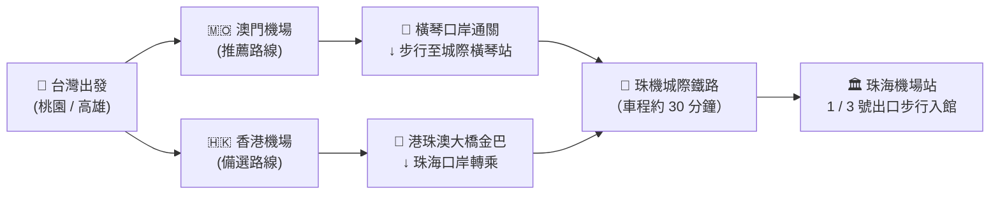
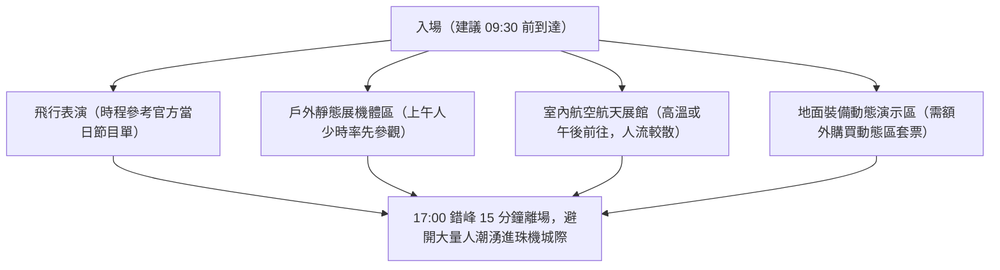

# 2026 珠海航展之旅完全攻略 ✈️🛳️

> **目的地**：中國廣東省珠海市  
> **活動**：第十六屆中國國際航空航天博覽會（珠海航展，創辦 30 週年）  
> **展期**：2026 年 12 月 7 日（週一）至 12 月 13 日（週日）  
> **適用對象**：持台胞證赴大陸觀展的台灣旅客

---

## 目錄 (Table of Contents)

- [1. 航展基本資料與行前倒數任務](#1-航展基本資料與行前倒數任務)
  - [1.1 一展三區總覽](#11-一展三區總覽)
  - [1.2 行前 D-14 ～ D-1 緊急檢核清單](#12-行前-d-14--d-1-緊急檢核清單)
- [2. 門票購買全攻略（台灣旅客版）](#2-門票購買全攻略台灣旅客版)
  - [2.1 購票管道與票價參考](#21-購票管道與票價參考)
  - [2.2 台胞證實名購票與入場注意事項](#22-台胞證實名購票與入場注意事項)
- [3. 交通動線全攻略](#3-交通動線全攻略)
  - [3.1 從台灣出發的最佳路線](#31-從台灣出發的最佳路線)
  - [3.2 展場當地交通（防塞車核心攻略）](#32-展場當地交通防塞車核心攻略)
- [4. 展區重點與建議參觀策略](#4-展區重點與建議參觀策略)
  - [4.1 金灣主展館（珠海國際航展中心）](#41-金灣主展館珠海國際航展中心)
  - [4.2 高欄港軍艦碼頭展區（本屆首創）](#42-高欄港軍艦碼頭展區本屆首創)
  - [4.3 斗門蓮洲無人系統展區](#43-斗門蓮洲無人系統展區)
- [5. 推薦行程規劃（4 天 3 夜公眾日版）](#5-推薦行程規劃4-天-3-夜公眾日版)
- [6. 住宿選擇與費用預算參考](#6-住宿選擇與費用預算參考)
- [7. 在地美食與珠澳周邊景點](#7-在地美食與珠澳周邊景點)
- [8. 行前打包清單](#8-行前打包清單)

---

## 1. 航展基本資料與行前倒數任務

### 1.1 一展三區總覽

| 展區 | 位置 | 開放對象 | 主要亮點 |
| :--- | :--- | :---: | :--- |
| **金灣主展館** | 珠海國際航展中心（金灣機場旁） | 專業日＋公眾日 | 飛行表演、室內航太展、靜態機體展示、地面裝備動態區 |
| **高欄港海上展區** | 高欄港軍艦碼頭 | 公眾日（部分開放） | 055型驅逐艦、075型兩棲攻擊艦、054A型護衛艦停泊參觀（**本屆首創**） |
| **蓮洲無人系統展區** | 斗門蓮洲（距主館約 53 公里） | **僅專業日** | 無人機、無人船動態演示、飛行汽車 |

---

### 1.2 行前 D-14 ～ D-1 緊急檢核清單

> [!IMPORTANT]
> 目前距離航展開幕（12/7）僅剩約 **12 天**，以下項目務必立即確認！

| 優先度 | 任務 | 狀態 |
| :---: | :--- | :--- |
| 🔴 緊急 | **台胞證有效期確認**（入場須攜帶正本，效期建議距截止日大於 6 個月） | - [ ] |
| 🔴 緊急 | **「大麥 APP」實名搶票**（個人票 CNY 600，優惠票 400；現場不設售票點） | - [ ] |
| 🔴 緊急 | **12306 預訂珠機城際去回程車票**（尖峰時段一票難求，務必同時訂好返程） | - [ ] |
| 🟠 重要 | **訂房**（金灣、橫琴、拱北周邊飯店已進入搶手期，越早越好） | - [ ] |
| 🟠 重要 | 辦理中國大陸電話卡或設定台灣電信商漫遊方案 | - [ ] |
| 🟡 建議 | 綁定「微信支付」或「支付寶」（大陸當地掃碼消費極度普及） | - [ ] |
| 🟡 建議 | 下載離線地圖（百度地圖／高德地圖）與「大麥」、「12306」App | - [ ] |
| 🟢 加分 | 若持有高欄港海上展區票，提前確認該展區交通接駁班次 | - [ ] |

---

## 2. 門票購買全攻略（台灣旅客版）

### 2.1 購票管道與票價參考

> [!CAUTION]
> **切勿向黃牛或非官方管道購票！** 官方指定唯一售票平台為「**大麥 APP**」（搜尋「第十六屆中國航展」），或由中國航展官方微信公眾號跳轉，現場絕無窗口售票。

| 票種 | 適用對象 | 參考票價（人民幣）|
| :--- | :--- | :---: |
| 個人票（單次入場） | 一般成人 | **¥ 600** |
| 優惠票 | 18 歲以下 / 60 歲以上 | **¥ 400** |
| 動態區套票 | 加購地面裝備動態演示區 | **¥ 800 起** |

> [!NOTE]
> 以上票價為本屆航展公眾日參考資訊，實際以官方大麥平台上架時公告為準。嬰幼兒同樣需購票，且不免費。

---

### 2.2 台胞證實名購票與入場注意事項

> [!IMPORTANT]
> **台灣旅客必看！**
> 1. 本屆航展明確支援以**「台灣居民來往大陸通行證（台胞證）」**進行實名購票。
> 2. 購票時填寫的姓名與證件號碼必須與台胞證**完全一致**，且「一人一票一證，不可轉讓或轉售」。
> 3. 入場時，使用台胞證購票者需攜帶**台胞證正本**，前往**人工核驗通道**（非閘機自動通道）辦理入場手續。
> 4. 請確認台胞證在活動期間（12/11–12/13）**仍在有效期內**。

---

## 3. 交通動線全攻略

### 3.1 從台灣出發的最佳路線

#### 🏆 推薦：飛澳門 ➜ 橫琴口岸 ➜ 珠機城際

| 步驟 | 詳細說明 | 預估時間 |
| :---: | :--- | :---: |
| 1 | 搭乘飛機至**澳門國際機場（MFM）** | 依航班 |
| 2 | 澳門機場搭乘巴士或的士至**橫琴口岸** | 20–40 分鐘 |
| 3 | 通關（台胞證）進入珠海橫琴，步行至**城際橫琴站** | 徒步約 5 分鐘 |
| 4 | 搭乘**珠機城際**，直達**珠海機場站** | 約 30 分鐘 |
| 5 | 由「1 號」或「3 號」出口步行至**珠海國際航展中心**入口 | 徒步約 5 分鐘 |

#### 備選：飛香港 ➜ 港珠澳大橋／高鐵

- **大橋金巴路線**：香港國際機場乘金巴跨港珠澳大橋 ➜ 珠海口岸 ➜ 轉珠機城際或航展專線巴士。
- **高鐵路線**：香港西九龍站 ➜ 廣州南站（約 48 分鐘）➜ 廣珠城際換乘 ➜ 珠海機場站。

---

### 3.2 展場當地交通（防塞車核心攻略）

> [!WARNING]
> 航展期間珠海國際航展中心周邊實施**嚴格交通管制**：
> - 無通行證的私家車、網約車（滴滴等）**無法直達展館門口**。
> - 自駕車必須停在遠端外圍停車場再換乘接駁巴士，往往比搭軌道交通更耗時。
> - **強烈建議全程依賴珠機城際鐵路**，出站即入館，零塞車。

| 交通方式 | 優點 | 缺點 |
| :--- | :--- | :--- |
| **珠機城際（強烈推薦）** | 準時、無塞車、直通展館 | 返程散場時排隊較長（建議錯峰 15 分鐘離場） |
| 航展官方專線巴士 | 彈性上車地點較多 | 需依官方公告確認路線與票價 |
| 自駕／網約車 | 彈性大 | 受管制、須停遠端停車場換乘 |

---

## 4. 展區重點與建議參觀策略

### 4.1 金灣主展館（珠海國際航展中心）

**建議停留時間：整整 1 天**

🌟 **本屆不可錯過的展出亮點**：

| 分類 | 亮點項目 |
| :--- | :--- |
| 🛩️ 飛行表演隊 | 俄羅斯「勇士」特技飛行表演隊、阿聯酋「騎士」表演隊 |
| ✈️ 軍機首展／飛演 | 殲-35 隱身艦載戰機、空警-600 艦載預警機、教-15 艦載教練機（航母五件套） |
| 🌙 航天展品 | 嫦娥五號（月球正面）＆ 嫦娥六號（月球背面）**採回月壤首度同框亮相** |

---

### 4.2 高欄港軍艦碼頭展區（本屆首創）

**建議停留時間：半天至 1 天（需獨立預約、遠離主館）**

> [!NOTE]
> 高欄港展區距離金灣主展館有一段距離，建議**排在不同天**單獨前往，不要試圖與主館同日串聯（否則交通往返會耗去大量觀展時間）。

**預計亮相艦艇（依官方公告為準）**：

- 055 型萬噸級驅逐艦（中國最強水面戰艦）
- 075 型兩棲攻擊艦（艦島型直升機航艦）
- 054A 型護衛艦

---

### 4.3 斗門蓮洲無人系統展區

> [!WARNING]
> 蓮洲展區通常**僅對「專業日」（12/8–12/10）開放**，一般公眾旅客**無法入場**。若您已具備專業觀眾資格認證，需注意此展區距主館約 53 公里（車程約 1 小時），請提前安排當日接駁或租車。

---

## 5. 推薦行程規劃（4 天 3 夜公眾日版）

> [!NOTE]
> 以下以「公眾日（12/11 週五 – 12/13 週日）」規劃為基礎，推薦「12/10 週四出發，12/13 週日返台」的 **4 天 3 夜行程**，讓首日有充分時間安頓住宿、熟悉路線。

---

### Day 1（12/10 週四）：飛抵珠海，安頓下榻

| 時段 | 建議行程 |
| :--- | :--- |
| 上午 | 搭乘班機飛往澳門（桃園出發建議選早班，約 1.5 小時航程） |
| 午後 | 澳門機場 ➜ 橫琴口岸通關（預留 30–60 分鐘排隊） ➜ 城際橫琴站搭乘珠機城際 |
| 下午 | 抵達珠海，前往飯店 Check-in、安頓行李 |
| 傍晚 | 步行熟悉住宿周邊環境（拱北口岸商圈、蓮花路小吃街），備好隔日帶進場的配備 |
| 晚上 | 在珠海享用早茶或海鮮晚餐，準備隔日早起 |

> [!TIP]
> 今日重點任務：**再次確認大麥 APP 門票二維碼可正常顯示，台胞證放在隨身包（切勿托運行李）！**

---

### Day 2（12/11 週五）：金灣主展館開幕公眾首日

| 時段 | 建議行程 |
| :--- | :--- |
| 08:00 | 由住宿地出發，前往城際鐵路車站（建議搭 08:30 前班次） |
| 09:00 | 抵達珠海機場站，台胞證人工通道辦理入場，快速進館 |
| 09:00–11:30 | **優先攻克戶外靜態展機體區**（開館前人少，可近距離拍攝、繞行參觀機體） |
| 11:30–12:30 | 在展館內或附近用餐（建議自備輕食或提早於展館內餐廳用餐，午餐高峰排隊驚人） |
| 12:30–15:00 | **室內航空航天展館**（下午是戶外人潮高峰期，轉戰室內剛好避曬） |
| 15:00–17:00 | 返回戶外觀看下午時段**飛行表演**（依節目單確認時程），搶占跑道側觀看位置 |
| 17:00 | 錯峰提前 15 分鐘離場，搭珠機城際返回市區 |
| 晚上 | 情侶路海濱散步＋珠海特色晚餐 |

---

### Day 3（12/12 週六）：高欄港海上展區（軍艦碼頭）

| 時段 | 建議行程 |
| :--- | :--- |
| 上午 | 出發前往**高欄港軍艦碼頭展區**（需依官方交通指引前往，建議搭官方接駁巴士） |
| 上午 – 午後 | **參觀停泊艦艇**：055 型萬噸驅逐艦、075 型兩棲艦甲板（若開放）、054A 護衛艦（請勿攜帶違禁品，碼頭安檢嚴格） |
| 下午 | 返回市區，前往**澳門半日遊**（由拱北口岸通關，步行進入澳門大炮台、大三巴） |
| 傍晚 | 在澳門官也街吃葡式蛋塔、豬扒包補血，再由拱北口岸返回珠海住宿 |

---

### Day 4（12/13 週日）：主展館補看＋整理＋返台

| 時段 | 建議行程 |
| :--- | :--- |
| 上午 | （選擇性）再入主展館補看昨日未逛完的展館或漏看裝備 |
| 中午 | 在珠海享用最後一頓在地美食（橫琴鮮生蠔、早茶必點） |
| 下午 | 整理行李，前往澳門機場搭機返台 |

> [!TIP]
> 返程交通預留充裕時間：由珠海橫琴口岸通關至澳門機場約 60–90 分鐘，航展最後一天口岸出境人潮大，**建議提早 3 小時出發**。

---

## 6. 住宿選擇與費用預算參考

### 住宿區域比較

| 區域 | 優點 | 缺點 | 適合對象 |
| :--- | :--- | :--- | :--- |
| **橫琴／拱北口岸周邊** | 通關最方便、商圈熱鬧、餐飲選擇多、珠機城際橫琴站步行可達 | 距主展館仍需 30 分鐘城際 | 🏆 一般旅客首選 |
| **香洲市區（珠海市中心）** | 生活機能最豐富、交通網路完整 | 需轉乘至珠機城際起點 | 多日停留、喜歡探索市區者 |
| **金灣機場周邊** | 距展館步行可達，節省交通時間 | 餐飲住宿選擇少、房價在航展期間大幅上漲 | 預算充裕的軍事迷 |

### 預算試算參考（4 天 3 夜 / 1 人）

> [!NOTE]
> 以下為粗估參考，匯率以 1 新台幣 ≒ 0.22 人民幣計算（實際依即時匯率調整）。

| 項目 | 預估費用（人民幣） | 換算新台幣（估） |
| :--- | :---: | :---: |
| 來回機票（台灣 ↔ 澳門） | — | NT$ 4,000–8,000 |
| 住宿（3 晚，橫琴附近中等飯店）| ¥ 600–1,500 | NT$ 2,700–6,800 |
| 金灣主展館門票（個人票） | ¥ 600 | NT$ 2,700 |
| 高欄港海上展區門票 | 待官方公告 | 待定 |
| 珠機城際來回（2 次） | ¥ 60–80 | NT$ 270–360 |
| 澳門往返橫琴交通費 | ¥ 50 | NT$ 230 |
| 餐飲（4 天估算） | ¥ 400–600 | NT$ 1,800–2,700 |
| **合計估算** | | **約 NT$ 12,000–21,000** |

---

## 7. 在地美食與珠澳周邊景點

### 🍽️ 珠海必吃美食

| 美食 | 推薦地點或說明 |
| :--- | :--- |
| **橫琴生蠔** | 橫琴以養殖蠔聞名，烤蠔、生蠔一條街任選，新鮮飽滿 |
| **廣式早茶（飲茶）** | 蝦餃、燒賣、腸粉、蘿蔔糕，建議早上 8–10 點前往 |
| **珠海海鮮大排檔** | 香洲漁女周邊或拱北口岸一帶，蒸魚、炒貝、白灼蝦 |
| **沙澳花生糕／光酥餅** | 珠海特產伴手禮，拱北口岸附近土特產商店均有售 |

### 🏯 澳門順遊景點（由拱北口岸通關）

- **大三巴牌坊**：標誌性歷史遺址，周邊鳳凰蛋（杏仁餅）必買。
- **大炮台**：葡萄牙要塞，可俯瞰澳門半島全景。
- **官也街**：豬扒包、葡式蛋塔各家名店密集，逛街掃貨首選。
- **路氹城（威尼斯人等）**：賭場大道購物或漫步威尼斯水道。

---

## 8. 行前打包清單

👉 點此展開「行前必備打包清單」（含服裝、攝影與 App 建議）

### 🧥 服裝與防護

- [ ] **洋蔥式穿搭**：12 月珠海均溫 15–22°C，白天戶外較暖、傍晚海風涼，建議內搭排汗衣＋薄外套＋一件厚外套（可綁腰）。
- [ ] 防曬帽（大帽簷）＋防曬乳（UV 指數仍高）
- [ ] 太陽眼鏡（觀看飛行表演時仰望天空必備）
- [ ] 舒適好走的運動鞋（單日步行超過 1.5 萬步是家常便飯）
- [ ] 輕便後背包（主展館安檢嚴格，避免攜帶帶輪大行李）

### 🎒 展場必備裝備

- [ ] 台胞證正本（入場核驗、全程放隨身包）
- [ ] 大麥 APP 門票二維碼（可截圖存入相簿作為備份）
- [ ] 行動電源（充電寶）：**容量限制為 20,000 mAh / 100Wh 以下**，安檢時請配合出示，超規格禁止入場。
- [ ] 摺疊椅（如需占位觀看飛行表演；展館內不禁止）
- [ ] 折疊雨傘（即使不是雨季，意外天氣可當遮陽傘用）

### 📷 攝影設備

- [ ] 相機或手機（飛行表演建議使用「連拍＋快門優先」模式）
- [ ] 長焦鏡頭或長焦手機（建議等效焦距 200mm 以上，機體靜態展可近距離補足）
- [ ] 備用電池或充電線（展場插座稀少，建議行動電源加滿）

### 📱 必備 App 與設定

| App | 用途 |
| :--- | :--- |
| **大麥** | 門票 QR Code 展示，請提前截圖備份 |
| **12306** | 珠機城際票務查詢與退改簽 |
| **百度地圖 / 高德地圖** | 下載珠海離線地圖，避免展場流量不足 |
| **微信 / 支付寶** | 綁定銀行卡（Visa 可用），用於大陸日常掃碼支付 |
| **台灣漫遊設定** | 開通中港澳漫遊，或購買廣東電信 / 中國移動 SIM 卡 |

---

## ⚠️ 重要聲明

> [!CAUTION]
> 本旅遊手冊所有票價、展期、展覽內容及交通資訊，均彙整自 **2026 年 11 月**可取得的公開報導與官方資訊，僅供行程規劃**參考**。實際展覽資訊以**官方正式公告**為準，出發前請務必至「中國航展」官方網站與「大麥 APP」再次核實各項細節。

---

*製作日期：2026-11-25 ✈️ 祝觀展愉快、一切順利！*
