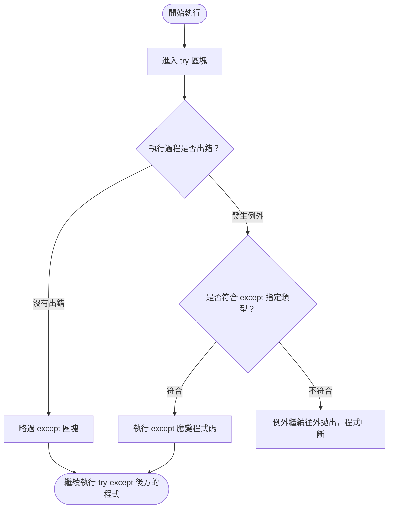
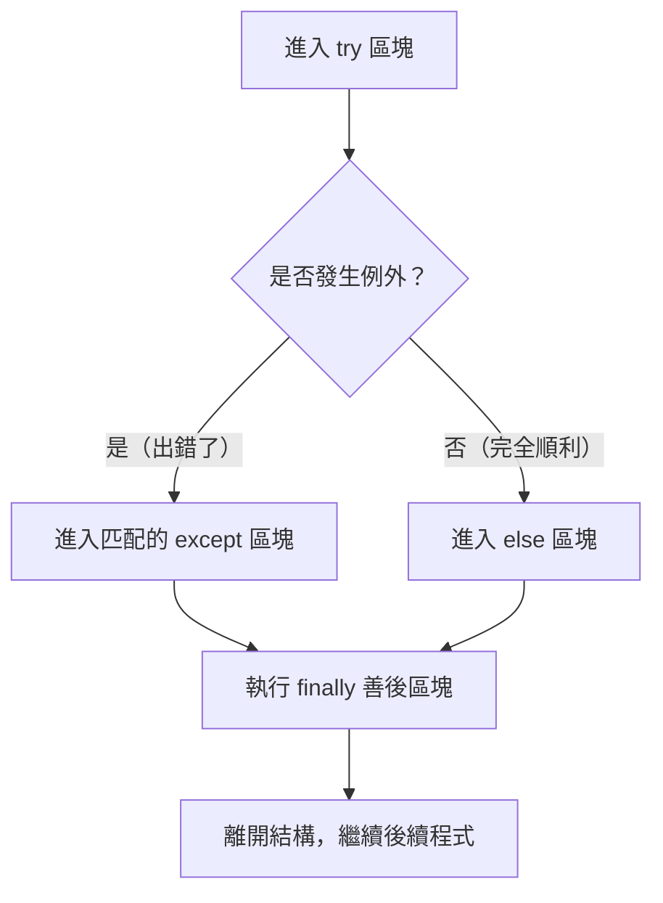

# Python `try-except` 例外處理講義：由淺至深實戰課

> **課程單元**：Python 例外處理（`try-except`）  
> **上課日期**：2026-11-25  
> **適用對象**：職能發展學院（TVDI）Python 程式設計學員  
> **環境需求**：Python 3.10+ / 3.12+（統一使用 `uv run python ...` 執行程式碼）

---

## 學習目標

上完這堂課後，你將能夠：

1. **看懂紅字不驚慌**：快速判讀 Python 報錯訊息（Traceback）中的關鍵線索。
2. **分清兩類錯誤**：區分「語法錯誤（`SyntaxError`）」與「執行期例外（`Exception`）」。
3. **寫出基本防護網**：使用 `try ... except` 精準捕捉特定錯誤，並用 `as` 讀取錯誤原因。
4. **掌握完整四重奏**：理解 `try ... except ... else ... finally` 各自的分工與執行順序。
5. **學會主動防呆**：理解 EAFP 思維，善用 `raise` 主動檢核不合理資料，並入門自訂例外。
6. **閃避新手地雷**：避開裸寫 `except:`、吞掉錯誤等常見除錯陷阱。

---

## 目錄 (Table of Contents)

- [1. 入門篇：為什麼需要「例外處理」？](#1-入門篇為什麼需要例外處理)
  - [1.1 程式突然當掉的現場：讀懂 Traceback](#11-程式突然當掉的現場讀懂-traceback)
  - [1.2 生活化比喻：搭車與外送的「備案思維」](#12-生活化比喻搭車與外送的備案思維)
  - [1.3 必分清楚：語法錯誤 (SyntaxError) vs 執行期例外 (Exception)](#13-必分清楚語法錯誤-syntaxerror-vs-執行期例外-exception)
- [2. 基礎篇：核心語法 `try ... except`](#2-基礎篇核心語法-try--except)
  - [2.1 最小可行結構與執行流程](#21-最小可行結構與執行流程)
  - [2.2 精準捕捉特定例外類型](#22-精準捕捉特定例外類型)
  - [2.3 初學者必識：常見內建例外家族表](#23-初學者必識常見內建例外家族表)
- [3. 進階捕捉篇：錯誤詳情 `as` 與多重例外處理](#3-進階捕捉篇錯誤詳情-as-與多重例外處理)
  - [3.1 用 `as` 取得系統錯誤訊息](#31-用-as-取得系統錯誤訊息)
  - [3.2 同時應對多種錯誤的兩種寫法](#32-同時應對多種錯誤的兩種寫法)
  - [3.3 排列順序鐵律：子類別在前、父類別在後](#33-排列順序鐵律子類別在前父類別在後)
- [4. 完整結構篇：`try ... except ... else ... finally` 四重奏](#4-完整結構篇try--except--else--finally-四重奏)
  - [4.1 四個區塊的職責分工與流程圖](#41-四個區塊的職責分工與流程圖)
  - [4.2 為什麼需要 `else`？縮小危險範圍](#42-為什麼需要-else縮小危險範圍)
  - [4.3 `finally` 的神聖保證：資源必定清理](#43-finally-的神聖保證資源必定清理)
- [5. 實戰設計篇：EAFP 思維、主動 `raise` 與自訂例外](#5-實戰設計篇eafp-思維主動-raise-與自訂例外)
  - [5.1 設計哲學：LBYL vs EAFP](#51-設計哲學lbyl-vs-eafp)
  - [5.2 主動出擊：使用 `raise` 檢核商業邏輯](#52-主動出擊使用-raise-檢核商業邏輯)
  - [5.3 進階延伸：自訂例外類別與例外鏈 (`from`)](#53-進階延伸自訂例外類別與例外鏈-from)
- [6. 除錯防雷篇：初學者最常犯的五大陷阱](#6-除錯防雷篇初學者最常犯的五大陷阱)
- [7. 課堂隨堂測驗與動手實作題](#7-課堂隨堂測驗與動手實作題)
  - [觀念測驗一：執行順序追蹤挑戰](#觀念測驗一執行順序追蹤挑戰)
  - [觀念測驗二：抓出 `except` 寫法地雷](#觀念測驗二抓出-except-寫法地雷)
  - [動手實作一：安全正整數轉換器](#動手實作一安全正整數轉換器)
  - [動手實作二：具除數防呆的簡易計算機](#動手實作二具除數防呆的簡易計算機)
- [8. 課後複習小抄 (Cheat Sheet)](#8-課後複習小抄-cheat-sheet)

---

## 1. 入門篇：為什麼需要「例外處理」？

### 1.1 程式突然當掉的現場：讀懂 Traceback

剛學 Python 時，最常在終端機看到一整段紅字報錯（稱為 **Traceback**，錯誤追蹤紀錄）。例如這段簡單的除法程式：

```python
# 假設使用者輸入了 "0"
raw_divisor = "0"
divisor = int(raw_divisor)
result = 100 / divisor  # 這一行會出錯並立即中斷程式
print(f"結果為：{result}")  # 這一行永遠不會被執行到
```

終端機輸出的訊息會長這樣：

```text
Traceback (most recent call last):
  File "demo.py", line 4, in <module>
    result = 100 / divisor
             ~~~~^~~~~~~~~
ZeroDivisionError: division by zero
```

> [!TIP]
> **讀懂紅字的黃金兩步驟**：
> 1. **先看最後一行**：得知「發生什麼錯誤」（`ZeroDivisionError`）與「原因」（`division by zero`）。
> 2. **再往上看行號**：找出是哪個檔案的第幾行觸發問題（`line 4`）。

---

### 1.2 生活化比喻：搭車與外送的「備案思維」

想像你今天早上要搭捷運來上課：

* **沒有例外處理的程式**：走到捷運站發現列車故障停駛，你就站在原地發呆直到天黑，整天的行程直接報銷（程式當機崩潰）。
* **有 `try-except` 的程式**：你心裡早有準備：「先試著搭捷運（`try`）；**萬一**遇到停駛（`except`），就立刻改騎 YouBike 或搭公車！」雖然發生突發狀況，但你依然能平安抵達教室，後續行程照常進行。

**例外處理（Exception Handling）的核心目的，就是替可能發生意外的程式碼準備好「緊急備案」**，避免整個程式因為單一錯誤而突然終止。

---

### 1.3 必分清楚：語法錯誤 (SyntaxError) vs 執行期例外 (Exception)

很多初學者會誤以為只要把程式包進 `try-except` 就永遠不會當機，其實不然！Python 的錯誤分成兩大類：

| 錯誤類別 | 英文名稱 | 發生時機 | 能否被 `try-except` 捕捉 | 常見案例 |
| :--- | :--- | :--- | :---: | :--- |
| **語法錯誤** | `SyntaxError` | **執行前**（Python 直譯器解析程式碼階段） | ❌ **不能** | `if` 後漏寫冒號 `:`、括號不成對、縮排亂掉 (`IndentationError`) |
| **執行期例外** | `Exception` | **執行中**（程式碼語法正確，但運行時遇到狀況） | ✅ **可以** | 除以零、`int("abc")` 轉換失敗、讀取不存在的檔案 |

> [!IMPORTANT]
> **語法鐵律**：
> `try-except` 只能處理「**執行期間**」發生的例外！若程式碼本身拼錯字或漏寫冒號，連進入 `try` 區塊的機會都沒有，必須直接修正程式碼本身。

#### ❌ 常見錯誤示範（語法錯誤無法被捕捉）

```python
# 錯誤：if 條件結尾忘記加冒號 ":"
# 執行前就會直接報錯：SyntaxError: expected ':'
try:
    if True
        print("這行無法解析")
except Exception:
    print("這裡永遠不會被觸發！")
```

---

## 2. 基礎篇：核心語法 `try ... except`

### 2.1 最小可行結構與執行流程

```python
try:
    # 1. 嘗試執行「可能會出錯」的程式碼
    ...
except 例外類型:
    # 2. 當指定例外真的發生時，改執行這裡的補救方案
    ...
```

透過流程圖了解程式走向：



---

### 2.2 精準捕捉特定例外類型

下面示範把使用者的文字輸入轉成整數並進行計算。當使用者輸入 `"二十"` 時，`int()` 會失敗並拋出 `ValueError`：

```python
# 模擬學員輸入一段無法轉成數字的文字
user_input = "二十"

try:
    # 只有這段型別轉換與計算具風險，因此放進 try 區塊
    age = int(user_input)
    years_left = 65 - age
    print(f"距離 65 歲退休還有 {years_left} 年")
except ValueError:
    # 精準攔截「數值內容不合法」的錯誤，給出白話提醒
    print("輸入格式有誤！請輸入半形阿拉伯數字（例如：25）。")

print("程式繼續往下執行，沒有當機！")
```

**輸出結果**：

```text
輸入格式有誤！請輸入半形阿拉伯數字（例如：25）。
程式繼續往下執行，沒有當機！
```

> [!NOTE]
> **思考問題**：為什麼上面要特別寫 `except ValueError:`，而不是直接寫成 `except:` 呢？  
> 因為如果程式碼裡其實還有「打錯變數名稱（`NameError`）」這種開發者自己的筆誤，寫 `except ValueError:` 能讓真正的程式臭蟲在測試時立刻曝光，不會被錯誤地當成「使用者輸入格式有誤」給掩蓋過去！

---

### 2.3 初學者必識：常見內建例外家族表

撰寫 `except` 時，最常見的內建例外有以下幾種：

| 例外類型 | 中文意涵 | 典型觸發程式碼範例 |
| :--- | :--- | :--- |
| `ValueError` | 數值內容不合法 | `int("abc")`（型別是字串沒錯，但內容無法轉成整數） |
| `TypeError` | 資料型別不支援該操作 | `"10" + 5`（字串不能直接和整數相加） |
| `ZeroDivisionError` | 除數為零 | `10 / 0` 或 `10 % 0` |
| `IndexError` | 串列 / 元組索引超出範圍 | `scores = [80, 90]; scores[5]` |
| `KeyError` | 字典找不到指定的鍵 (Key) | `user = {"name": "小華"}; user["age"]` |
| `FileNotFoundError` | 找不到檔案路徑 | `open("not_exist.txt", encoding="utf-8")` |

---

## 3. 進階捕捉篇：錯誤詳情 `as` 與多重例外處理

### 3.1 用 `as` 取得系統錯誤訊息

如果我們想知道 Python 原生的詳細錯誤描述（例如除錯或記錄日誌用），可以用 `as 變數名稱` 把例外物件接起來：

```python
raw_price = "NT$100"

try:
    price = int(raw_price)
except ValueError as value_err:
    # type(value_err).__name__ 可印出例外類別名稱
    print(f"發生例外類別：{type(value_err).__name__}")
    print(f"系統詳細說明：{value_err}")
```

**輸出結果**：

```text
發生例外類別：ValueError
系統詳細說明：invalid literal for int() with base 10: 'NT$100'
```

---

### 3.2 同時應對多種錯誤的兩種寫法

當一段程式可能出現超過一種風險（例如：先轉型、再從串列取值、最後做除法），我們有兩種處理風格：

#### 寫法一：多個 `except` 分門別類應對（最推薦）

```python
items = [100, 200, 300]
raw_index = "1"
raw_divisor = "0"

try:
    target_index = int(raw_index)             # 可能觸發 ValueError
    selected_value = items[target_index]      # 可能觸發 IndexError
    quotient = selected_value / int(raw_divisor)  # 可能觸發 ValueError 或 ZeroDivisionError
    print(f"計算結果：{quotient}")
except ValueError as value_err:
    print(f"[輸入格式錯誤] 請輸入整數編號與除數！（詳情：{value_err}）")
except IndexError:
    print(f"[索引超界] 目前僅有 {len(items)} 筆資料，請確認編號範圍。")
except ZeroDivisionError:
    print("[數學運算錯誤] 除數不可為 0。")
```

#### 寫法二：用元組 `(例外1, 例外2)` 合併處理相同動作

若好幾種錯誤發生後的補救方式完全一樣，可以用元組打包：

```python
raw_numerator = "10"
raw_denominator = "0"

try:
    answer = int(raw_numerator) / int(raw_denominator)
    print(f"相除結果：{answer}")
except (ValueError, ZeroDivisionError) as calc_err:
    # 兩種錯誤的處理邏輯相同時，可寫在同一個 tuple 裡
    print(f"無法完成除法計算：{calc_err}")
```

---

### 3.3 排列順序鐵律：子類別在前、父類別在後

Python 會由上往下依序比對 `except`，**只要命中第一個符合（含繼承父類別）的區塊就會進入執行，底下其餘區塊一律略過**。

由於常見例外（如 `ZeroDivisionError`、`ValueError`）都繼承自 `Exception`：

#### ❌ 錯誤順序（父類別擋住子類別）

```python
try:
    result = 10 / 0
except Exception as err:
    # Exception 範圍太大，直接把所有錯誤攔截走了
    print(f"通用攔截：{err}")
except ZeroDivisionError:
    # 這一塊永遠沒有機會被執行（成為無效程式碼）
    print("這裡寫了白寫，永遠印不到！")
```

#### ✅ 正確順序（具體的子類別放前面，兜底的父類別放最後）

```python
try:
    result = 10 / 0
except ZeroDivisionError:
    print("精準處理：除數不能是 0！")
except Exception as err:
    print(f"其他未預期的系統例外：{err}")
```

---

## 4. 完整結構篇：`try ... except ... else ... finally` 四重奏

在實務開發中，完整的例外處理還有 `else` 與 `finally` 兩位好夥伴：

```python
try:
    # 1. 嘗試執行「最核心且可能出錯」的程式碼
    ...
except 特定例外:
    # 2. 只有當 try 發生對應例外時才執行
    ...
else:
    # 3. 只有當 try 「完全沒有發生例外」時才執行
    ...
finally:
    # 4. 不管有沒有出錯，最後「保證一定會執行」的善後清理
    ...
```

### 4.1 四個區塊的職責分工與流程圖



---

### 4.2 為什麼需要 `else`？縮小危險範圍

> [!TIP]
> **思考問題**：為什麼不把所有正常運算都直接寫在 `try` 裡面，還要多寫一個 `else` 呢？  
> 原因很簡單：**避免誤抓！**  
> 如果你把後面的正常邏輯也塞進 `try`，萬一後面某行不小心噴出同名錯誤（例如本來想保護第 1 行的 `int()` 轉換 `ValueError`，結果第 5 行別的函式也噴出 `ValueError`），`except` 會把第 5 行的錯誤一起吃掉，讓你誤以為是第 1 行出問題！

```python
raw_score = "88"

try:
    # try 只包住「把輸入文字轉成整數」這件最危險的事
    score = int(raw_score)
except ValueError:
    print("分數必須是整數數字！")
else:
    # 確定轉換成功後，才進入正常商業邏輯判斷
    status = "及格" if score >= 60 else "需要補考"
    print(f"成績登記完成：{score} 分（{status}）")
```

---

### 4.3 `finally` 的神聖保證：資源必定清理

無論 `try` 順利跑完、跳進 `except`、**甚至在 `try` 裡面已經執行了 `return`**，`finally` 區塊都保證會在離開函式前執行完畢，非常適合拿來關閉連線或釋放鎖定資源：

```python
def run_task_with_cleanup(should_fail: bool) -> str:
    """示範即使提前 return，finally 仍會先執行完畢。"""
    print("1. 啟動任務資源...")
    try:
        if should_fail:
            raise ValueError("模擬作業失敗")
        print("2. 任務核心步驟順利完成")
        return "SUCCESS"
    except ValueError as err:
        print(f"2. 捕捉到錯誤：{err}")
        return "FAILED"
    finally:
        # 不論回傳 SUCCESS 或 FAILED，這行都會在 return 離開前執行
        print("3. [finally] 釋放資源與清理暫存完成")


status_text = run_task_with_cleanup(should_fail=False)
print(f"最終狀態：{status_text}")
```

**輸出結果**：

```text
1. 啟動任務資源...
2. 任務核心步驟順利完成
3. [finally] 釋放資源與清理暫存完成
最終狀態：SUCCESS
```

> [!NOTE]
> **現代 Python 資源管理補充**：如果是單純開啟檔案（`open()`），在實務上更推薦使用 `with open(...) as file_obj:` 語法（Context Manager），它底層就自動幫你做好類似 `try ... finally` 關閉檔案的保證，程式碼更簡潔！

---

## 5. 實戰設計篇：EAFP 思維、主動 `raise` 與自訂例外

### 5.1 設計哲學：LBYL vs EAFP

在檢查資料或處理邊界條件時，工程師常討論兩種風格：

* **LBYL（Look Before You Leap，三思而後行）**：事前用大量 `if` 先檢查各種條件，通過才執行。
* **EAFP（Easier to Ask for Forgiveness than Permission，先斬後奏／Pythonic 風格）**：假設大部分情況都會成功，直接執行核心邏輯，真的出錯再用 `try-except` 接住。

```python
student_scores = {"小明": 92, "小華": 85}
query_name = "阿豪"

# 寫法一：LBYL（事前檢查字典裡有沒有這個鍵）
if query_name in student_scores:
    print(f"成績：{student_scores[query_name]}")
else:
    print(f"查無學員 {query_name}")

# 寫法二：EAFP（直接讀取，找不到鍵時交給 KeyError 處理）
try:
    print(f"成績：{student_scores[query_name]}")
except KeyError:
    print(f"查無學員 {query_name}")
```

> [!TIP]
> 簡單單層判斷（例如檢查 `b == 0` 或字典 `.get()`）用 `if` 很清楚；但當涉及**字串轉數值、檔案開啟、外部 API 請求**這類事前很難完美檢查、或檢查成本比直接試跑還高的操作時，**EAFP（`try-except`）會讓程式碼更乾淨直覺**。

---

### 5.2 主動出擊：使用 `raise` 檢核商業邏輯

有時候程式本身不會讓 Python 直譯器報錯，但**結果違反現實規則或商業邏輯**（例如：提款金額是負數、除數是零時想給出明確的中文錯誤提示）。這時我們用 `raise` 主動拋出例外！

```python
def divide(numerator: int | float, denominator: int | float) -> float:
    """計算兩數相除，當除數為 0 時主動拋出中文錯誤訊息。"""
    if denominator == 0:
        # 主動拋出帶有清楚中文說明的 ValueError，取代較生硬的系統英文錯誤
        raise ValueError("除數不可為零")
    return numerator / denominator


# 呼叫端透過 try-except 捕捉並呈現訊息
try:
    print(divide(12, 3))   # 正常輸出 4.0
    print(divide(10, 0))   # 觸發我們主動拋出的 ValueError
except ValueError as err:
    print(f"計算失敗：{err}")
```

**輸出結果**：

```text
4.0
計算失敗：除數不可為零
```

---

### 5.3 進階延伸：自訂例外類別與例外鏈 (`from`)

在較大型的專案裡，如果只靠內建的 `ValueError`，有時很難分辨「哪一個業務規則出錯」。這時只要繼承 `Exception`，就能建立專案專屬的例外類別；若想把底層技術錯誤轉換成高階業務錯誤並保留原始錯誤原因，則可使用 `raise ... from ...`：

```python
class InsufficientBalanceError(Exception):
    """自訂例外：帳戶餘額不足時拋出。"""

    def __init__(self, balance: int, amount: int) -> None:
        self.balance = balance
        self.amount = amount
        super().__init__(f"餘額不足：目前僅有 {balance} 元，無法提款 {amount} 元")


def withdraw(balance: int, amount: int) -> int:
    """模擬簡易提款檢查。"""
    if amount <= 0:
        raise ValueError("提款金額必須大於 0")
    if amount > balance:
        raise InsufficientBalanceError(balance, amount)
    return balance - amount


try:
    withdraw(1000, 1500)
except InsufficientBalanceError as err:
    # 可以讀取自訂例外物件上夾帶的 balance 與 amount 屬性
    print(f"交易拒絕：{err}（差額：{err.amount - err.balance} 元）")
```

**輸出結果**：

```text
交易拒絕：餘額不足：目前僅有 1000 元，無法提款 1500 元（差額：500 元）
```

---

## 6. 除錯防雷篇：初學者最常犯的五大陷阱

> [!WARNING]
> 以下五種寫法看起來「好像不會當機」，實際上是實務開發中最危險的反模式（Anti-patterns）：

### 地雷 1：裸寫 `except:` 不指定類型

```python
# ❌ 錯誤示範：連使用者按 Ctrl+C (KeyboardInterrupt) 或 SystemExit 都會被攔截！
try:
    raw_value = input("請輸入數字：")
    number = int(raw_value)
except:
    print("發生了未知錯誤")
```

* **修正方式**：至少寫 `except Exception as err:`，最好是明確指定 `except ValueError:`。

---

### 地雷 2：吃掉錯誤只寫 `pass`（靜默失敗）

```python
# ❌ 錯誤示範：出錯後什麼都沒留，後面程式卻繼續使用未定義或錯誤的狀態
try:
    discount_rate = float("八折")
except ValueError:
    pass

# 下一行會突然爆出：NameError: name 'discount_rate' is not defined
# print(1000 * discount_rate)
```

* **修正方式**：發生例外時一定要給予明確的提示、紀錄或指派安全預設值，或改用 `raise` 往上回報。

---

### 地雷 3：把 `except Exception:` 放在具體例外上面

```python
# ❌ 錯誤示範：上面攔光了，底下的 KeyError 永遠執行不到
try:
    config = {"port": 8080}
    host = config["host"]
except Exception:
    print("系統例外")
except KeyError:
    print("缺少 host 設定")
```

* **修正方式**：先寫 `except KeyError:`，最後才寫 `except Exception:`。

---

### 地雷 4：把整個函式塞進巨無霸 `try` 區塊

* **問題**：一個 `try` 裡包含讀檔、轉型、計算、資料庫寫入 20 行程式碼，最後只用一個 `except ValueError:` 接住，除錯時完全不知道是哪一行壞掉。
* **修正方式**：只把真正會引發該錯誤的那 1～3 行放進 `try`，其餘正常步驟交給 `else` 或獨立拆分成小函式。

---

### 地雷 5：在 `finally` 裡面寫 `return`

```python
# ❌ 錯誤示範：finally 裡的 return 會把原本拋出的 ValueError 直接吞沒！
def risky_check() -> str:
    try:
        raise ValueError("原本應該被看到的錯誤！")
    finally:
        return "一切正常"  # ⚠️ 這會覆蓋掉上面的 ValueError！


print(risky_check())  # 竟然印出「一切正常」，錯誤完全消失！
```

* **修正方式**：`finally` 只負責「清理資源」與「收尾動作」，不要在裡面寫 `return` 或 `break`。

---

## 7. 課堂隨堂測驗與動手實作題

### 觀念測驗一：執行順序追蹤挑戰

請問下列函式執行 `trace_flow(10, 2)` 與 `trace_flow(10, 0)` 時，各自會印出哪幾行文字、回傳值分別是什麼？

```python
def trace_flow(numerator: int, denominator: int) -> float | None:
    try:
        answer = numerator / denominator
        return answer
    except ZeroDivisionError:
        print("A. 捕捉到除以零")
    else:
        print("B. 除法成功")
    finally:
        print("C. 清理結束")
```

<details>
<summary>👉 點此展開查看【觀念測驗一解答與解析】</summary>

1. **`trace_flow(10, 2)`**：
   - 印出：`C. 清理結束`
   - 回傳值：`5.0`
   - **解析**：在 `try` 區塊裡執行到 `return answer` 時，程式準備回傳 `5.0`，因此**跳過了 `else`（不會印出 B）**，但因為 `finally` 絕對保證執行，所以仍會先印出 `C` 再把 `5.0` 回傳。
   - **延伸提醒**：若希望 `else` 也被執行，應該把 `return answer` 移到 `else` 區塊中。
2. **`trace_flow(10, 0)`**：
   - 印出：`A. 捕捉到除以零` 接著 `C. 清理結束`
   - 回傳值：`None`（因為 `except` 區塊沒有寫 `return`）

</details>

---

### 觀念測驗二：抓出 `except` 寫法地雷

下列程式碼有哪些不妥之處？（提示：至少有兩個問題）

```python
def parse_age(raw_text: str) -> int:
    try:
        return int(raw_text)
    except Exception:
        return 0
    except ValueError:
        print("請輸入正確年齡")
        return -1
```

<details>
<summary>👉 點此展開查看【觀念測驗二解答與解析】</summary>

1. **`except` 順序顛倒**：`Exception` 是 `ValueError` 的父類別，放在上方會攔截所有例外，導致下方的 `except ValueError:` 永遠不會被執行，傳入 `"abc"` 時會直接回傳 `0` 而非 `-1`。
2. **隱藏其他非預期錯誤**：因為上方寫了過於寬泛的 `except Exception:`，萬一程式內部寫錯（如 `TypeError` 或 `NameError`）也會被直接吃掉並默默回傳 `0`，不利於除錯。

</details>

---

### 動手實作一：安全正整數轉換器

**題目說明**：  
請在本地建立練習檔案並使用 `uv run python <檔名>.py` 執行測試，實作一個函式 `parse_positive_int(raw_text: str) -> int | None`：

1. 嘗試使用 `int(raw_text.strip())` 將文字轉為整數。
2. 若轉換後的整數小於或等於 `0`，主動 `raise ValueError("數字必須大於 0")`。
3. 當發生 `ValueError` 時，印出友善提示 `f"輸入無效：{err}"` 並回傳 `None`。
4. 當轉換完全成功且大於 `0` 時，在 `else` 區塊回傳該整數。

<details>
<summary>👉 點此展開查看【動手實作一參考解答】</summary>

```python
def parse_positive_int(raw_text: str) -> int | None:
    """將輸入字串安全轉換為正整數，失敗時印出提示並回傳 None。"""
    try:
        # 去除前後空白後轉型；若不是數字文字，int() 會自動拋出 ValueError
        number = int(raw_text.strip())
        if number <= 0:
            # 主動拒絕非正整數，統一由下方的 except ValueError 處理
            raise ValueError("數字必須大於 0")
    except ValueError as err:
        print(f"輸入無效：{err}")
        return None
    else:
        return number


# 測試不同情境
if __name__ == "__main__":
    test_cases = [" 42 ", "0", "-5", "abc"]
    for sample in test_cases:
        parsed = parse_positive_int(sample)
        print(f"輸入 {sample!r} -> 結果：{parsed}")
```

**預期輸出**：
```text
輸入 ' 42 ' -> 結果：42
輸入無效：數字必須大於 0
輸入 '0' -> 結果：None
輸入無效：數字必須大於 0
輸入 '-5' -> 結果：None
輸入無效：invalid literal for int() with base 10: 'abc'
輸入 'abc' -> 結果：None
```

</details>

---

### 動手實作二：具除數防呆的簡易計算機

**題目說明**：  
請設計一個涵蓋 `match-case`（Python 3.10+）、`raise` 與完整 `try-except-else-finally` 的簡易四則運算函式：

1. 定義 `calculate(left: int | float, operator: str, right: int | float) -> float`：
   - 支援 `"+"`、`"-"`、`"*"`、`"/"`。
   - 當 `operator == "/"` 且 `right == 0` 時，主動拋出 `ValueError("除數不可為零")`。
   - 若傳入不支援的運算符號，主動拋出 `ValueError(f"不支援的運算符號：{operator}")`。
2. 撰寫 `safe_run_calculation(left: int | float, operator: str, right: int | float) -> None`：
   - 呼叫 `calculate(...)` 並用 `try ... except ValueError as err ... else ... finally ...` 印出計算結果或錯誤訊息，最後於 `finally` 印出 `"--- 本次計算結束 ---"`。

<details>
<summary>👉 點此展開查看【動手實作二參考解答】</summary>

```python
def calculate(left: int | float, operator: str, right: int | float) -> float:
    """執行基本四則運算，對除數為零與無效運算子拋出 ValueError。"""
    match operator:
        case "+":
            return float(left + right)
        case "-":
            return float(left - right)
        case "*":
            return float(left * right)
        case "/":
            if right == 0:
                raise ValueError("除數不可為零")
            return left / right
        case _:
            raise ValueError(f"不支援的運算符號：{operator}")


def safe_run_calculation(left: int | float, operator: str, right: int | float) -> None:
    """安全執行計算並展示 try-except-else-finally 四段流程。"""
    try:
        result = calculate(left, operator, right)
    except ValueError as err:
        print(f"[計算錯誤] {err}")
    else:
        print(f"[計算成功] {left} {operator} {right} = {result}")
    finally:
        print("--- 本次計算結束 ---")


if __name__ == "__main__":
    safe_run_calculation(12, "/", 3)
    safe_run_calculation(10, "/", 0)
    safe_run_calculation(5, "^", 2)
```

**預期輸出**：
```text
[計算成功] 12 / 3 = 4.0
--- 本次計算結束 ---
[計算錯誤] 除數不可為零
--- 本次計算結束 ---
[計算錯誤] 不支援的運算符號：^
--- 本次計算結束 ---
```

</details>

---

## 8. 課後複習小抄 (Cheat Sheet)

```python
try:
    # 只放真正可能發生執行期例外的關鍵步驟
    ...
except SpecificError as err:
    # 精準處理特定例外（子類別放上面）
    ...
except (ErrorA, ErrorB) as err:
    # 多種例外共用同一種補救邏輯
    ...
else:
    # try 完全成功時才執行（不要把所有邏輯塞進 try）
    ...
finally:
    # 無論成功或失敗（甚至提前 return）都保證會執行的清理收尾
    ...
```

* [ ] 我分得清楚 `SyntaxError`（執行前）與 `Exception`（執行中）。
* [ ] 我會寫特定例外名稱，避免無差別裸寫 `except:`。
* [ ] 我知道 `except` 順序要「小範圍子類別在前、大範圍父類別在後」。
* [ ] 我能使用 `raise ValueError("...")` 主動攔截不合理的引數。
