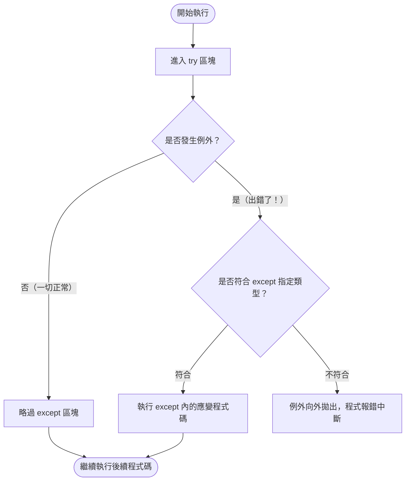
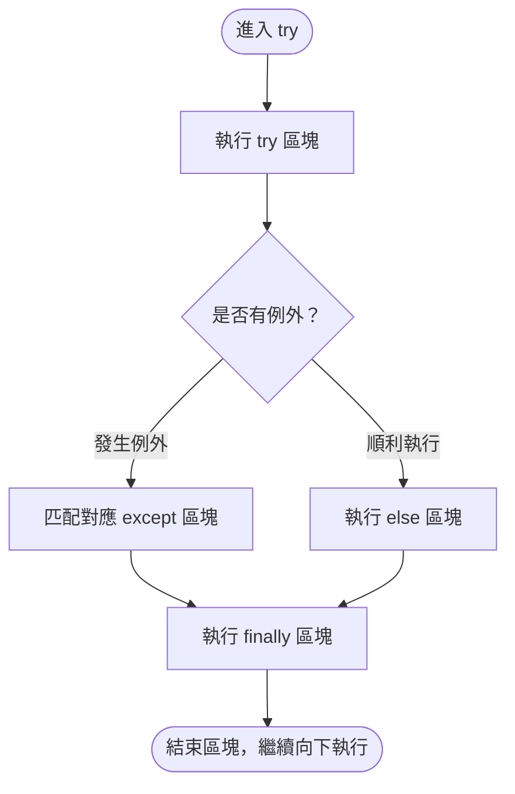
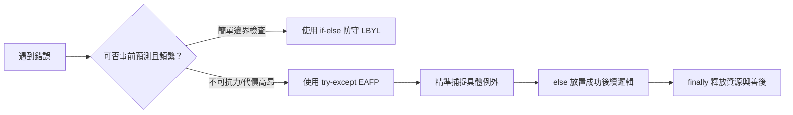

# Python 例外處理完全指南：從防禦到優雅應對 🛡️

> **課程單元**：Python 核心語法 — 例外處理（Exception Handling）  
> **上課日期**：2026-11-28（下午場）  
> **適用對象**：職能發展學院 Python 程式設計學員  
> **環境需求**：Python 3.10+（建議使用 uv 進行套件與環境管理）  

---

## 學習目標 🎯

1. **破除恐懼**：讀懂 Python 紅字報錯（Traceback），不再害怕看到程式出錯。
2. **釐清觀念**：搞懂「語法錯誤（SyntaxError）」與「例外（Exception）」的本質差異。
3. **掌握核心語法**：熟練運用 `try ... except ... else ... finally` 四大金剛組合。
4. **領悟 Pythonic 思維**：理解 LBYL（三思而後行）與 EAFP（先斬後奏）的設計哲學。
5. **主動防禦**：學會使用 `raise` 主動拋出錯誤，並設計自訂例外類別（Custom Exception）。
6. **避免地雷**：避開初學者最常犯的「吃掉錯誤」、「裸寫 except」等反模式（Anti-patterns）。

---

## 目錄 (Table of Contents)

- [1. 生活化導讀：什麼是「例外（Exception）」？](#1-生活化導讀什麼是例外exception)
  - [1.1 程式當掉的崩潰日常](#11-程式當掉的崩潰日常)
  - [1.2 生活比喻：出門與捷運停駛](#12-生活比喻出門與捷運停駛)
  - [1.3 語法錯誤 (Syntax Error) vs 例外 (Exception)](#13-語法錯誤-syntax-error-vs-例外-exception)
- [2. 為什麼需要例外處理？（LBYL vs EAFP）](#2-為什麼需要例外處理lbyl-vs-eafp)
  - [2.1 LBYL：三思而後行（傳統防守）](#21-lbyl三思而後行傳統防守)
  - [2.2 EAFP：先斬後奏（Pythonic 優雅）](#22-eafp先斬後奏pythonic-優雅)
  - [2.3 兩種寫法實例對決](#23-兩種寫法實例對決)
- [3. 例外處理基本功：try 與 except](#3-例外處理基本功try-與-except)
  - [3.1 基礎語法與執行流程](#31-基礎語法與執行流程)
  - [3.2 捕捉特定錯誤：精準打擊](#32-捕捉特定錯誤精準打擊)
  - [3.3 取得錯誤訊息：as e 的妙用](#33-取得錯誤訊息as-e-的妙用)
  - [3.4 一次捕捉多種例外](#34-一次捕捉多種例外)
  - [3.5 初學者必背！常見內建例外家族](#35-初學者必背常見內建例外家族)
- [4. 進階完整結構：try - except - else - finally 四重奏](#4-進階完整結構try---except---else---finally-四重奏)
  - [4.1 四重奏職責架構圖](#41-四重奏職責架構圖)
  - [4.2 為什麼需要 else？（別把程式全塞在 try 裡）](#42-為什麼需要-else別把程式全塞在-try-裡)
  - [4.3 finally 的神聖使命：資源必定清理](#43-finally-的神聖使命資源必定清理)
  - [4.4 實務綜合演練：安全讀取檔案與計算](#44-實務綜合演練安全讀取檔案與計算)
- [5. 主動出擊：raise 與自訂例外類別](#5-主動出擊raise-與自訂例外類別)
  - [5.1 為什麼要主動引發例外？（商業邏輯檢核）](#51-為什麼要主動引發例外商業邏輯檢核)
  - [5.2 使用 raise 拋出內建例外](#52-使用-raise-拋出內建例外)
  - [5.3 打造自己的例外類別（自訂 Exception）](#53-打造自己的例外類別自訂-exception)
  - [5.4 例外重新引發（Re-raise）與鏈結（from）](#54-例外重新引發re-raise與鏈結from)
- [6. 初學者最常踩的五大天坑 (Common Pitfalls)](#6-初學者最常踩的五大天坑-common-pitfalls)
- [7. 課堂隨堂實作與觀念測驗](#7-課堂隨堂實作與觀念測驗)
  - [測驗一：抓出觀念地雷（閱讀理解題）](#測驗一抓出觀念地雷閱讀理解題)
  - [實作題一：安全數值輸入器 (Safe Input Converter)](#實作題一安全數值輸入器-safe-input-converter)
  - [實作題二：ATM 提款防呆驗證系統](#實作題二atm-提款防呆驗證系統)

---

## 1. 生活化導讀：什麼是「例外（Exception）」？

### 1.1 程式當掉的崩潰日常

寫程式時，大家一定都遇過這個場景：開開心心寫了一百行程式碼，跑得順風順水，突然終端機噴出一整片刺眼的**紅色錯誤文字（Traceback）**，程式瞬間中斷結束：

```text
Traceback (most recent call last):
  File "main.py", line 4, in <module>
    result = 10 / divisor
             ~~~^~~~~~~~~
ZeroDivisionError: division by zero
```

初學者看到紅字往往心跳漏半拍，覺得自己「寫錯了」。但請先放寬心：  
**「出錯是軟體開發的日常，而學會優雅地處理錯誤，才是專業工程師的必修課！」**

---

### 1.2 生活比喻：出門與捷運停駛

試想一下日常生活的場景：

* **完全沒防備**：你打算搭捷運去上課，到了捷運站發現鐵捲門拉下、廣播說「訊號異常暫停營運」。如果你毫無備案，只能站在原地抱頭痛哭、不知所措（**程式當機崩潰，Crash！**）。
* **有例外處理**：你在出門前就設想好「*如果捷運停駛（發生例外狀況），我就改騎 YouBike 或搭公車（應變措施，except 處理）*」。雖然捷運壞了，但你依然能順利抵達教室，生活照常運轉！

在 Python 中，**例外處理（Exception Handling）** 就是給程式準備的**「應變備案」**。當不可預期的狀況發生時，程式不會暴斃，而是能冷靜地執行替代方案。

---

### 1.3 語法錯誤 (Syntax Error) vs 例外 (Exception)

在開始處理錯誤前，必須先分清這兩大類問題：

| 類型 | 英文名 | 發生時機 | 能否用 try-except 挽救？ | 舉例 |
| :--- | :--- | :--- | :---: | :--- |
| **語法錯誤** | **SyntaxError** | **解析前（執行前）** | ❌ **不能** | 括號沒對齊、少寫冒號 `:`、單引號沒閉合 |
| **例外狀況** | **Exception** | **執行中（Runtime）** | ✅ **可以** | 除以零、找不到檔案、串列索引超出範圍 |

> [!IMPORTANT]
> **重要鐵律**：
> `try-except` **只能捕捉「執行階段（Runtime）」產生的例外**！  
> 如果你的程式碼本身有語法錯誤（例如少了冒號 `:`），Python 在編譯轉換成 Bytecode 階段就會直接拒絕執行，根本輪不到 `try` 登場救援！

#### ❌ 語法錯誤範例（無法被捕捉）：
```python
# 語法錯誤：缺少冒號，Python 連跑都不會跑
try:
    if True
        print("Hello")
except Exception:
    print("這裡永遠抓不到！")
```

#### ✅ 例外狀況範例（可以被優雅捕捉）：
```python
# 語法完全合法，但執行時才會發現「除數是零」
try:
    result = 10 / 0
except ZeroDivisionError:
    print("抓到了！除數不能為零，已改用預設值 0 代替。")
```

---

## 2. 為什麼需要例外處理？（LBYL vs EAFP）

在程式設計領域，處理潛在錯誤有兩種完全不同的哲學：

### 2.1 LBYL：三思而後行（傳統防守）
* **全名**：*Look Before You Leap*（跳過去之前先看仔細）
* **風格**：大量使用 `if-else`，在做每一件事之前，鉅細靡遺地檢查所有邊界條件。
* **缺點**：條件判斷層層巢狀，程式碼看起來臃腫雜亂；且有時檢查過後、執行當下環境卻變了（例如剛檢查檔案存在，要讀時檔案剛好被別的軟體刪了，產生 Race Condition）。

### 2.2 EAFP：先斬後奏（Pythonic 優雅）
* **全名**：*Easier to Ask for Forgiveness than Permission*（事後尋求原諒比事前取得許可容易）
* **風格**：**Python 官方極力推薦的設計哲學！** 大膽假設事情會順利運作，直接放手去做；一旦真的出錯了，在 `except` 區塊再來收拾殘局。
* **優點**：核心業務邏輯乾淨流暢，不需要充斥著一大堆前置防禦判斷。

---

### 2.3 兩種寫法實例對決

#### 情境：從字典中取出學員成績並印出

```python
student_scores = {"小明": 95, "小美": 88}
student_name = "阿豪"

# ----------------------------------------------------
# 寫法 A：LBYL 風格（傳統 if-else 事前反覆檢查）
# ----------------------------------------------------
if student_name in student_scores:
    print(f"{student_name} 的成績是：{student_scores[student_name]}")
else:
    print(f"查無學員 {student_name} 的資料！")

# ----------------------------------------------------
# 寫法 B：EAFP 風格（Pythonic，先執行、出錯再補救）
# ----------------------------------------------------
try:
    print(f"{student_name} 的成績是：{student_scores[student_name]}")
except KeyError:
    print(f"查無學員 {student_name} 的資料！")
```

> [!TIP]
> **助教觀點**：
> 雖然簡單查詢可以用字典的 `.get()` 方法，但在牽涉複雜操作（如型別轉換、網路請求、檔案讀寫）時，EAFP 的 `try-except` 能讓主邏輯一目了然，不需要為了防範幾百種罕見異常而寫出一長串又臭又長的 `if-else`。

---

## 3. 例外處理基本功：try 與 except

### 3.1 基礎語法與執行流程

最基礎的例外處理結構包含 `try` 與 `except`：

```python
try:
    # 這裡放「可能發生錯誤」的危險程式碼區塊
    pass
except 例外類型:
    # 這裡放「當指定例外發生時」的緊急應變處理措施
    pass
```

我們透過流程圖來看看它的運作路徑：



---

### 3.2 捕捉特定錯誤：精準打擊

請看以下讓使用者輸入年齡並計算離退休還有幾年的範例：

```python
# 沒有例外處理的脆弱程式碼：
# 若使用者輸入非數字（如 "abc"），int() 會噴出 ValueError 造成當機
user_input = "十八"  # 模擬使用者輸入
try:
    age = int(user_input)
    years_to_retire = 65 - age
    print(f"距離退休還有 {years_to_retire} 年！")
except ValueError:
    # 當 int() 轉換失敗時觸發
    print("輸入格式錯誤！請輸入半形阿拉伯數字（如 18）。")

print("👉 程式順利運行完畢，沒有當機！")
```

---

### 3.3 取得錯誤訊息：as e 的妙用

有時候我們不只想捕捉錯誤，還想知道**官方詳細的錯誤原因**是什麼，這時可以使用 `as` 關鍵字將例外物件指派給一個變數（通常命名為 `e` 或 `err`）：

```python
try:
    number = int("Python好棒")
except ValueError as e:
    print(f"捕捉到錯誤！型態為：{type(e).__name__}")
    print(f"系統錯誤描述訊息：{e}")
```

**輸出結果**：
```text
捕捉到錯誤！型態為：ValueError
系統錯誤描述訊息：invalid literal for int() with base 10: 'Python好棒'
```

> [!NOTE]
> `e` 是一個例外物件實例，將它用 `print(e)` 印出或以 `str(e)` 轉換，就能得到 Python 直譯器提供的原生錯誤原因說明。

---

### 3.4 一次捕捉多種例外

在一個運算過程中，可能同時潛伏著好幾種不同的錯誤威脅。例如：讓使用者輸入數字作為除數，並從串列中取出對應資料。

#### 寫法一：分門別類，個別應對（推薦 ✅）
```python
numbers = [10, 20, 30]

try:
    raw_index = "1"
    raw_divisor = "0"
    
    idx = int(raw_index)           # 可能發生 ValueError
    target = numbers[idx]          # 可能發生 IndexError
    result = target / int(raw_divisor)  # 可能發生 ZeroDivisionError

except ValueError as e:
    print(f"【輸入錯誤】請確保輸入的是合法的整數數字！（詳情：{e}）")

except IndexError as e:
    print(f"【索引超界】要求的索引不存在於串列中！（詳情：{e}）")

except ZeroDivisionError:
    print("【數學錯誤】除數不可以是 0 喔！")
```

#### 寫法二：統一打包（若處理方式相同）
若好幾種錯誤的處置方式完全一樣，可以用**元組（Tuple）**將例外類型包裹起來：

```python
try:
    result = 100 / int("abc")
except (ValueError, ZeroDivisionError) as e:
    print(f"數值運算失敗：{e}")
```

---

### 3.5 初學者必背！常見內建例外家族

在 Python 中，所有例外都具備繼承關係，源頭是 `BaseException` ➜ `Exception`。  
以下是課堂與實務開發中最常打交道的幾位「常客」：

| 例外名稱 | 中文意涵 | 常見觸發情境 |
| :--- | :--- | :--- |
| `ValueError` | 數值內容錯誤 | 傳入的值型別對，但內容不合法（如 `int("abc")`） |
| `TypeError` | 型別錯誤 | 對不支援的型別進行運算（如 `"5" + 5`） |
| `ZeroDivisionError` | 除以零錯誤 | 任何除法或取餘數運算時除數為 0（如 `10 / 0`） |
| `IndexError` | 索引超出範圍 | 訪問串列或元組不存在的位置（如 3 元素串列取 `[99]`） |
| `KeyError` | 鍵值不存在 | 讀取字典不存在的 key（如 `user["password"]`） |
| `FileNotFoundError` | 檔案不存在 | 開啟不存在的檔案路徑（如 `open("ghost.txt")`） |
| `AttributeError` | 屬性或方法不存在 | 呼叫物件不具備的方法（如整數呼叫 `123.append(4)`） |

---

## 4. 進階完整結構：try - except - else - finally 四重奏

當我們要編寫具備高強壯度（Robustness）的企業級程式碼時，單靠 `try-except` 還不夠。Python 提供了完整的四重奏結構：

```python
try:
    # 1. 嘗試執行的核心危險程式碼
    pass
except SomeError:
    # 2. 發生特定錯誤時執行
    pass
else:
    # 3. 完全沒有發生任何錯誤時才執行！
    pass
finally:
    # 4. 無論有沒有出錯，最後「絕對保證一定會執行」的清理工作
    pass
```

### 4.1 四重奏職責架構圖



---

### 4.2 為什麼需要 else？（別把程式全塞在 try 裡）

> [!WARNING]
> **常見壞習慣**：很多初學者喜歡把後續所有無關的程式碼全都塞在 `try` 裡面。  
> 這樣做的大缺點是：如果後續程式碼不小心也引發了同名例外，你會分不清楚到底是「前面出錯」還是「後面出錯」，造成幽靈除錯困擾！

`else` 的精神是：**「只有當 try 裡面的危險動作 100% 成功過關，才來做這件事」**。

```python
# 正確範例：明確劃分危險區與正常業務邏輯
raw_data = "120"

try:
    # 危險動作：只把最容易出問題的轉換放在 try 裡
    voltage = float(raw_data)
except ValueError:
    print("轉換失敗：請輸入正確的電壓數值！")
else:
    # 確定成功拿到電壓後，才進行正常邏輯運算
    power = voltage * 2.5
    print(f"電壓正常，計算出功率為：{power} W")
```

---

### 4.3 finally 的神聖使命：資源必定清理

`finally` 區塊擁有 Python 中最高的「信守承諾度」。  
**不管是程式正常結束、發生了被捕捉的錯誤、甚至是沒被捕捉的嚴重錯誤、甚至是遇到了 `return`**，`finally` 裡面的程式碼都**保證一定會被執行**！

最經典的用途是：**釋放資源、關閉檔案、中斷資料庫連線、釋放鎖定**。

```python
def check_finally_behavior():
    try:
        print("步驟 1：正在執行 try 區塊...")
        return "回傳結果：任務成功"
    except Exception:
        print("步驟 2：捕捉到例外")
    finally:
        # 即使 try 裡面已經執行了 return，finally 依然會先跑完！
        print("步驟 3：【finally】強制善後執行完畢！")

# 觀察執行順序
status = check_finally_behavior()
print(status)
```

**輸出結果**：
```text
步驟 1：正在執行 try 區塊...
步驟 3：【finally】強制善後執行完畢！
回傳結果：任務成功
```

---

### 4.4 實務綜合演練：安全讀取檔案與計算

這是一個展示四個區塊協同運作的完整案例：

```python
def calculate_class_average(file_path: str) -> None:
    """從文字檔案讀取成績並計算班級平均分數。"""
    file_handle = None
    try:
        print(f"嘗試開啟檔案：{file_path}")
        file_handle = open(file_path, "r", encoding="utf-8")
        lines = file_handle.readlines()
        
        # 逐行轉換分數
        scores = [float(line.strip()) for line in lines]
        average = sum(scores) / len(scores)

    except FileNotFoundError:
        print(f"❌ 錯誤：找不到指定的成績檔案 '{file_path}'！")
    except ValueError as val_err:
        print(f"❌ 錯誤：檔案內容包含無法轉成數字的資料！（{val_err}）")
    except ZeroDivisionError:
        print("❌ 錯誤：檔案是空的，無法計算平均！")
    else:
        # 只有在完全無錯誤時才印出成績單
        print("✅ 成績計算成功！")
        print(f"全班總人數：{len(scores)} 人，平均分數：{average:.2f} 分")
    finally:
        # 無論前面成功或失敗，只要檔案有被打開，就一定要關閉以防佔用記憶體
        if file_handle is not None and not file_handle.closed:
            file_handle.close()
            print("🔒 [系統資訊] 成績檔案已安全關閉。")

# 測試：呼叫一個不存在的檔案
calculate_class_average("missing_scores.txt")
```

---

## 5. 主動出擊：raise 與自訂例外類別

### 5.1 為什麼要主動引發例外？（商業邏輯檢核）

到目前為止，我們都是被動地等待 Python 直譯器報錯。但在真實專案中，**許多問題在語法上完全合法，卻嚴重違反商業規則**：
* 提款金額輸入 `-500` 元（Python 運算完全不會報錯，但現實中行不通！）
* 使用者註冊時年齡輸入 `300` 歲（型別是整數，但邏輯荒謬！）

這時我們必須化被動為主動，使用 **`raise`** 主動拋出例外，即時制止不合理的流程！

---

### 5.2 使用 raise 拋出內建例外

```python
def withdraw_money(balance: int, amount: int) -> int:
    """模擬銀行提款邏輯。"""
    # 檢查提款金額是否合法
    if amount <= 0:
        # 主動舉報不合法的數值
        raise ValueError(f"提款金額必須大於 0，您輸入的是：{amount}")
    
    if amount > balance:
        # 餘額不足也是一種邏輯錯誤
        raise RuntimeError(f"帳戶餘額不足！當前餘額：{balance}，欲提款：{amount}")
    
    balance -= amount
    return balance

# 測試主動拋出例外
try:
    current_balance = 1000
    current_balance = withdraw_money(current_balance, -200)
except ValueError as error:
    print(f"警報攔截：{error}")
```

---

### 5.3 打造自己的例外類別（自訂 Exception）

當內建的 `ValueError` 或 `RuntimeError` 無法精確表達你的領域需求時，你可以自己定義專屬的例外類別。  
**做法非常簡單：只要繼承 `Exception` 即可！**

```python
# 1. 建立自訂例外基礎類別（推薦架構）
class BankingSystemError(Exception):
    """銀行系統基礎例外類別。"""
    pass

# 2. 細分具體的商業例外
class InsufficientFundsError(BankingSystemError):
    """餘額不足例外。"""
    def __init__(self, balance: int, amount: int) -> None:
        self.balance = balance
        self.amount = amount
        self.shortage = amount - balance
        super().__init__(f"提款失敗：餘額不足！尚缺 {self.shortage} 元。")

class AccountLockedError(BankingSystemError):
    """帳戶遭凍結例外。"""
    pass

# 3. 在業務邏輯中使用自訂例外
def safe_atm_withdraw(account_status: str, balance: int, amount: int) -> int:
    if account_status == "LOCKED":
        raise AccountLockedError("此帳戶已被凍結，請洽臨櫃辦理！")
    
    if amount > balance:
        raise InsufficientFundsError(balance, amount)
    
    return balance - amount

# 4. 捕捉自訂例外
try:
    safe_atm_withdraw(account_status="ACTIVE", balance=3000, amount=5000)
except InsufficientFundsError as err:
    print(f"🚨 [交易失敗] {err}")
    print(f"💡 系統提示：目前可用餘額為 {err.balance} 元，差額為 {err.shortage} 元。")
except AccountLockedError as err:
    print(f"🔒 [安全通報] {err}")
```

> [!TIP]
> **物件導向設計優勢**：  
> 自訂例外類別可以夾帶專屬的屬性（例如上面的 `self.shortage` 缺額），捕捉到例外的程式碼可以直接拿這些屬性來做更貼心的 UI 提示！

---

### 5.4 例外重新引發（Re-raise）與鏈結（from）

在分層架構中，底層函式捕捉到錯誤後，可能想「先記下一筆紀錄（Log），再把錯誤繼續往上丟給上層處理」，這時可以單獨寫一個 `raise`：

```python
def connect_database():
    try:
        # 模擬連線失敗
        raise ConnectionRefusedError("無法連接到資料庫伺服器")
    except ConnectionRefusedError as err:
        print("[日誌記錄] 已記錄連線失敗事件至記錄檔中...")
        # 原封不動再次往外拋出，讓呼叫者決定怎麼向使用者顯示
        raise
```

若想要把一個底層例外轉換成自訂的高階商業例外，推薦使用 Python 的 `raise ... from ...` 語法（例外鏈）：

```python
class PaymentGatewayError(Exception):
    """金流通道例外。"""
    pass

try:
    # 模擬低階網路錯誤
    result = 1 / 0
except ZeroDivisionError as original_error:
    # 保留原始引發原因，包裝成業務錯誤拋出
    raise PaymentGatewayError("金流結帳系統異常") from original_error
```

---

## 6. 初學者最常踩的五大天坑 (Common Pitfalls)

請各位同學在寫扣時，務必對照以下五點自我檢視：

### 🚫 地雷 1：裸寫 `except:`（無差別吃掉所有錯誤）
```python
# ❌ 極度危險寫法：
try:
    do_something()
except:
    pass
```
* **危險原因**：裸寫的 `except:` 連 `KeyboardInterrupt`（使用者在終端機按 Ctrl+C 強制中止）和 `SystemExit` 都會吃掉！導致你想關掉程式都關不掉。
* **正確做法**：至少指定捕捉 `except Exception:`，且最好能明確指定特定類型。

---

### 🚫 地雷 2：把通用父類別寫在子類別前面
```python
# ❌ 邏輯順序錯誤：
try:
    num = 10 / 0
except Exception:          # Exception 是所有常見例外的老祖宗
    print("抓到通用例外！")
except ZeroDivisionError:  # 這行永遠沒有機會被執行到！
    print("除以零了！")
```
* **原因**：Python 匹配 `except` 是由上而下尋找符合的第一個。如果把大範圍的父類別放上面，底下的子類別就全成了死碼（Dead Code）。
* **正確做法**：**具體細部的例外放上面，通用廣泛的例外放最下面！**

---

### 🚫 地雷 3：把錯誤「靜悄悄」吞掉（Silent Failure）
```python
# ❌ 幽靈除錯噩夢：
try:
    user_id = data["user_id"]
except KeyError:
    pass  # 什麼都不印、也不處理
```
* **原因**：當程式往下跑時，變數 `user_id` 根本沒產生，會在十幾行之後引發更詭異的 `NameError`，讓你完全找不到一開始的犯罪現場。
* **正確做法**：至少印出警告訊息、賦予安全的預設值，或是記錄進 Log。

---

### 🚫 地雷 4：在 `finally` 區塊裡面寫 `return`
```python
# ❌ 語法陷阱：
def dangerous_func():
    try:
        raise ValueError("原本的大錯誤！")
    finally:
        return "偷天換日"  # 這會把前面的 ValueError 直接抹除！

print(dangerous_func())  # 印出：偷天換日，錯誤完全消失無蹤！
```
* **原因**：`finally` 中的 `return` 會強制覆蓋掉 `try` 或 `except` 裡的所有回傳值以及尚未處理的例外。

---

### 🚫 地雷 5：巨無霸 try 區塊（包山包海）
```python
# ❌ 範圍過大：
try:
    data = load_file()
    parsed = parse_json(data)
    user = authenticate(parsed)
    save_to_db(user)
    send_email(user)
except Exception as e:
    print(f"出錯了：{e}")  # 到底哪一步壞掉？無從得知！
```
* **正確做法**：縮小 `try` 的範圍，只保護真正具有不可抗力風險的操作，讓錯誤責任清晰明確。

---

## 7. 課堂隨堂實作與觀念測驗

### 測驗一：抓出觀念地雷（閱讀理解題）

請閱讀以下程式碼，回答三個問題：

```python
def divide_items(items: list[int], index: int, divisor: int) -> float:
    try:
        val = items[index]
        res = val / divisor
        return res
    except ZeroDivisionError:
        print("【A】除數不可為零")
    except IndexError:
        print("【B】索引超出串列範圍")
    except Exception:
        print("【C】其他未預期錯誤")
    else:
        print("【D】計算大成功")
    finally:
        print("【E】清理階段結束")

# 觀察以下呼叫：
# 呼叫 1：divide_items([10, 20], 1, 2)
# 呼叫 2：divide_items([10, 20], 5, 2)
# 呼叫 3：divide_items([10, 20], 0, 0)
```

**問題**：
1. 呼叫 1 會印出哪些代號字串？函式回傳值是多少？
2. 呼叫 2 會印出哪些代號字串？函式回傳值是多少？
3. 為什麼【D】在呼叫 1 時有印出或沒印出？（請特別注意 `return` 的時機）

<details>
<summary>👉 點此展開查看【測驗一答案與詳細解析】</summary>

**答案**：
1. **呼叫 1**：印出 `【E】清理階段結束`，回傳 `10.0`。  
   *原因*：在 `try` 區塊中計算出 `res = 10.0` 並直接執行了 `return res`！一旦在 `try` 內提前 `return`，程式會先跳去執行 `finally`【E】，然後將結果回傳，因此 `else`【D】**不會被執行**！
2. **呼叫 2**：依序印出 `【B】索引超出串列範圍` 與 `【E】清理階段結束`，函式回傳 `None`（因為沒有顯式 return）。
3. **呼叫 3**：依序印出 `【A】除數不可為零` 與 `【E】清理階段結束`，回傳 `None`。

> [!TIP]
> **教學重點**：若希望 `else` 區塊被正常執行，請不要在 `try` 區塊內寫 `return`，而是把 `return` 放在 `else` 區塊中！

</details>

---

### 實作題一：安全數值輸入器 (Safe Input Converter)

**題目需求**：  
請撰寫一個名為 `get_safe_integer` 的函式：
1. 接收兩個參數：`prompt: str`（提示訊息）與 `default_value: int`（當使用者輸入失敗時的預設值，預設為 `0`）。
2. 使用 `input()` 取得使用者輸入。
3. 嘗試將輸入內容轉為整數。
4. 若使用者輸入無效字元（如輸入空白、文字），捕捉 `ValueError`，印出友善提醒，並回傳預設值。
5. 若使用者在終端按下 `Ctrl+C`（觸發 `KeyboardInterrupt`），印出 `"使用者強制中斷操作"` 並結束程式。

<details>
<summary>👉 點此展開查看【實作題一參考解答】</summary>

```python
def get_safe_integer(prompt: str, default_value: int = 0) -> int:
    """安全取得整數輸入的防呆函式。"""
    try:
        user_text = input(prompt).strip()
        result = int(user_text)
        return result
    except ValueError as val_err:
        print(f"⚠️ 輸入內容非合法整數！已為您套用預設值：{default_value}")
        return default_value
    except KeyboardInterrupt:
        print("\n🛑 使用者強制中斷輸入流程！")
        return default_value

# 測試範例（可於本機執行測試）：
if __name__ == "__main__":
    age = get_safe_integer("請輸入您的年齡：", default_value=18)
    print(f"最終登記年齡為：{age} 歲")
```

</details>

---

### 實作題二：ATM 提款防呆驗證系統

**題目需求**：  
設計一個整合「自訂例外」與「四重奏流程」的 ATM 提款模擬器：
1. 自訂一個例外類別 `WithdrawalLimitError`（單筆提款上限例外，上限為 20,000 元）。
2. 自訂一個例外類別 `InsufficientBalanceError`（餘額不足例外）。
3. 撰寫提款函式 `atm_withdraw(current_balance: int, withdraw_amount: int) -> int`：
   - 若提款金額 <= 0，拋出標準 `ValueError`。
   - 若提款金額 > 20,000，拋出 `WithdrawalLimitError`。
   - 若提款金額 > 帳戶餘額，拋出 `InsufficientBalanceError`。
   - 若皆符合規定，扣除餘額並回傳新餘額。
4. 使用 `try ... except ... else ... finally` 進行完整交易流程呼叫與印出收據明細。

<details>
<summary>👉 點此展開查看【實作題二參考解答】</summary>

```python
# 1. 定義自訂例外類別
class ATMError(Exception):
    """ATM 系統基礎例外類別。"""
    pass

class WithdrawalLimitError(ATMError):
    """超過單筆提款限額（20,000 元）。"""
    def __init__(self, amount: int, limit: int = 20000) -> None:
        super().__init__(f"提款金額 NT${amount:,} 超出單筆提款上限 NT${limit:,}！")

class InsufficientBalanceError(ATMError):
    """帳戶餘額不足。"""
    def __init__(self, balance: int, amount: int) -> None:
        super().__init__(f"帳戶餘額不足！目前餘額：NT${balance:,}，欲提領：NT${amount:,}")

# 2. 核心提款運算邏輯
def atm_withdraw(current_balance: int, withdraw_amount: int) -> int:
    if withdraw_amount <= 0:
        raise ValueError("提款金額必須為正整數！")
    
    if withdraw_amount > 20000:
        raise WithdrawalLimitError(amount=withdraw_amount, limit=20000)
    
    if withdraw_amount > current_balance:
        raise InsufficientBalanceError(balance=current_balance, amount=withdraw_amount)
    
    new_balance = current_balance - withdraw_amount
    return new_balance

# 3. 交易流程整合控制
def process_atm_transaction(balance: int, amount: int) -> None:
    print(f"\n===== 開始處理提款交易（申請提領 NT${amount:,}）=====")
    updated_balance = balance
    
    try:
        updated_balance = atm_withdraw(balance, amount)
    except ValueError as e:
        print(f"❌ [參數錯誤]：{e}")
    except WithdrawalLimitError as e:
        print(f"⚠️ [超額警示]：{e}")
    except InsufficientBalanceError as e:
        print(f"💸 [餘額不足]：{e}")
    except ATMError as e:
        print(f"🚨 [系統異常]：{e}")
    else:
        print("🎉 鈔票點算中，請自出鈔口取款！")
        print(f"💰 交易成功！帳戶剩餘餘額：NT${updated_balance:,}")
    finally:
        print("💳 請記得取回您的金融卡與交易明細明細表。祝您事事順心！")
        print("==================================================")

# 測試各種情境
if __name__ == "__main__":
    my_balance = 35000
    
    # 情境 A：正常成功提款
    process_atm_transaction(my_balance, 5000)
    
    # 情境 B：超過單筆 2 萬上限
    process_atm_transaction(my_balance, 25000)
    
    # 情境 C：提款超過帳戶總額
    process_atm_transaction(1000, 3000)
    
    # 情境 D：輸入負數金額
    process_atm_transaction(my_balance, -100)
```

</details>

---

## 8. 總結心法與複習檢核表 📝



* [ ] 永遠**精準捕捉**特定例外（如 `ValueError`、`KeyError`），拒絕盲目的裸寫 `except:`。
* [ ] 謹記 **EAFP**（先斬後奏）是 Python 的設計哲學，善用例外處理能讓主程式碼乾淨好讀。
* [ ] `try` 區塊只放「真正危險」的操作，後續業務邏輯移至 `else`。
* [ ] 不管程式執行順序如何，檔案或網路連線等外部資源清理務必交給 `finally`。
* [ ] 面對業務規則衝突，勇敢使用 `raise` 引發內建或自訂例外！

---
*講義製作：職能發展學院（TVDI）Python 課程團隊*  
*授權宣告：供教學與學員課後自修使用*
